# GFMSv0.3 – HR Detailed Architecture Design v0.6

**Document:** `GFMSv0.3_HR_DETAILED_ARCHITECTURE_DESIGN_v0.6.md`  
**Version:** 0.6 (Cross-Validated Engineering Specification Addressing All 12 Review Findings on `v0.5`)  
**Supersedes:** `GFMSv0.3_HR_DETAILED_ARCHITECTURE_DESIGN_v0.5.md`  
**Prior Review Addressed:** `GFMSv0.3_HR_FINAL_TECHNICAL_REVIEW_v0.5.md` (`F-01`–`F-14`) + Owner `v0.5` Audit Findings (`C-01`–`C-12`)  
**Date:** 2026-11-16  
**Target Authoritative Repository Baseline:** `eslamsamirkhalil6-creator/gfm` (`main` @ `789f2fdc2e1c4ae766a579b867fa4b169080a8b7`)  
**Baseline Verification Disclosure:** The runtime container does **not** include a `.git` directory, so Git commit `789f2fdc2e1c4ae766a579b867fa4b169080a8b7` cannot be locally Git-verified in this container. All referenced source files (`database/migrations/001`–`006`, `database/seeds/001`–`007`, `backend/src/**`, `frontend/src/**`, `docs/**`) were directly inspected against the current workspace files.  
**Execution Mode:** Strictly Read-Only Specification Revision Only *(Zero application source files, SQL migrations `001`–`006` or `007+`, seeds `001`–`007`, routes, permissions, frontend components, roadmap files, or prior artifacts were created or modified.)*  
**Live PostgreSQL 14+ Verification (Gate B):** **NOT VERIFIED / PENDING** *(Container runtime executes on `pg-mem`; Gate B remains blocked until verified against a live PostgreSQL 14+ instance.)*  
**Authorization Status:** `HR-DEC-01` through `HR-DEC-14` remain **`REQUIRES OWNER APPROVAL`**. **No implementation or migration `007+` is authorized.**

---

## 1. Executive Summary & Scope Baseline

### 1.1 Purpose
This `v0.6` specification resolves all **12 technical contradictions and enforcement gaps (`C-01` through `C-12`)** identified during full-text review of `v0.5`, while preserving all prior `F-01`–`F-14` resolutions and existing GFMS foundations (Authentication/JWT, RBAC, `UserService`, `DepartmentService`, `WarehouseMasterService`, `ProductionService`, `PlanningService`, `AuditService`, and `withTransaction`).

### 1.2 Summary of `v0.6` Corrections (`C-01`–`C-12`)
1. **`C-01` DDL & Step Ordering:** Moved `hr_documents` DDL and Mode A metadata endpoints strictly to **Step 2** (before Step 4 `hr_contracts` and Step 6 `hr_leave_requests`), reserving Step 7 for Asset Custody + optional Mode B encrypted binary upload (`attach-file`).
2. **`C-02` & `C-11` Maker-Checker Deadlock Elimination (Single-`HR Manager` Safe):** Redesigned **Workflows #2, #6, #8, and #9** so Requester, Subject, Step 1 Reviewer, and Final Approver are always distinct users without assuming multiple `HR Manager` accounts exist.
3. **`C-03` Termination Workflow Enforcement:** Removed direct `TERMINATED` / `TERMINATION_PENDING` mutations from `PUT /api/hr/employees/:id/status`; mandated execution exclusively via **`POST /api/hr/employees/:id/terminations` (`hr_termination_requests`, Policy #8)** with atomic 12-source dependency re-verification on final approval.
4. **`C-04` True Two-Phase Idempotency Protocol:** Replaced the impossible single-transaction `IN_PROGRESS` claim in `v0.5` with a committed reservation transaction (`Phase 1` + `lease_expires_at`), atomic business + `COMPLETED` commit (`Phase 2`), stale-lease crash recovery, rollback delete cleanup, and bounded expired-key purge.
5. **`C-05` Confidential DDL & Redaction Honesty:** Added `bank_account_encrypted` to `hr_employee_confidential_profiles`; explicitly declared `base_salary`, `medical_notes`, and `disciplinary_summary` as DB-isolated/RBAC-protected (NOT application-encrypted); and defined the redacted `Factory Manager` `ApprovalContextDto` (`GET /api/hr/compensation-revisions/:id/approval-context`).
6. **`C-06` Leave Advance `CHECK` Reconciliation:** Removed the contradictory `allow_next_year_leave_advance_days` setting; formally enforced **Zero Uninitialized Advance (`0` days)** in Phase 08A matching `CHECK (pending_days + used_days <= entitled_days + carried_over_days)` (unpaid leave `deducts_balance_snapshot = FALSE` remains exempt).
7. **`C-07` `TERMINATION_PENDING` Defense-in-Depth:** Defined an explicit `7`-route self-service clearance allowlist + deny-by-default middleware gate (`403 EMPLOYMENT_STATUS_TERMINATION_PENDING`) AND transactional service-layer `assertActorOperationallyActive` guards across Approvals, WMS, Planning, Departments, Production, and HR.
8. **`C-08` `SUSPENDED` vs. Independent IT Security Lock:** Added `users.deactivation_source` (`ADMIN_MANUAL | IT_SECURITY_LOCK | HR_SUSPENSION | HR_TERMINATION`), preventing HR unsuspension from unlocking `IT_SECURITY_LOCK` and preventing IT from unlocking active `HR_SUSPENSION`.
9. **`C-09` Offline Duplicate Punch Reconciliation:** Added `hr_attendance_sync_batches` (`duplicate_ignored_count`) and removed the impossible `IGNORED_DUPLICATE` row state from `hr_attendance_raw_punches` (returning `IGNORED_DUPLICATE` cleanly in batch item results without violating `UNIQUE (device_id, external_punch_id)`).
10. **`C-10` Reliable External Document Purge:** Added `PURGE_PENDING -> PURGED` two-phase tombstoning (`purge_attempts`, `last_purge_error`, `purge_completed_at`) + `POST /api/hr/documents/:id/purge-retry`, guaranteeing zero orphaned ciphertext on external I/O failure and immediate `410 GONE` download blocking.
11. **`C-12` Full Cross-Section Re-Validation:** Re-verified all `37` new tables (`6` Shared + `26` Core HR Phase 08A + `5` Phase 11), `ALTER TABLE users` additive columns, `59` route-group specifications, `46` permissions, `9` workflows, and `9` implementation steps with concrete pass/fail validation scenarios.

---

## 2. `v0.6` Corrections Register & Cross-Validation Matrix (`C-01` – `C-12`)

| ID | Original Contradiction in `v0.5` | Corrected Rule in `v0.6` | Cross-References Updated | Validation Scenario (Pass & Failure Cases) |
|---|---|---|---|---|
| **`C-01`** | `v0.5` §3.2 labeled `hr_documents` as `Step 2/7`, while §11.1 created `hr_documents` in **Step 7** after Step 4 (`hr_contracts.document_id REFERENCES hr_documents(id)`) and Step 6 (`hr_leave_requests.document_id REFERENCES hr_documents(id)`), causing step-by-step SQL FK failure (`relation "hr_documents" does not exist`). | **Move `hr_documents` DDL (#13) and Mode A metadata-only registration/retention/legal-hold/purge services strictly to Step 2.** Step 4 (`hr_contracts`) and Step 6 (`hr_leave_requests`) cleanly reference pre-existing `hr_documents`. Step 7 implements only `hr_asset_custody`, `hr_asset_custody_events`, and optional Mode B binary upload/encryption (`POST .../attach-file`). | §1.2 (#1), §3.1, §3.2 (#13, #18, #28, #31–#32), §4.1 (#36a–#36e), §11.1 (Step 2 vs. Step 7), §12 | **Pass:** Executing Steps 1→2→3→4→5→6→7 in isolated migrations runs without forward FK errors; Step 4 `hr_contracts` links to Mode A `hr_documents`. **Fail:** Attempting to run Step 4 migration on an empty DB without Step 2 fails deterministically on missing `hr_documents`/`hr_employees`. |
| **`C-02`** | Workflows #2 (`HR_LEAVE_DEPT_MGR`), #6 (`HR_CONTRACT_RENEWAL`), #8 (`HR_TERMINATION`), and #9 (`HR_EMPLOYEE_REHIRE`) assumed >1 `HR Manager` or allowed `Requester === Step1/FinalApprover` (violating `trg_approval_steps_maker_checker`, `hr_contracts.created_by <> approved_by`, and single-actor multi-step bans). | **Explicit Single-`HR Manager`-Safe Routing:** (a) **#2 (`HR_LEAVE_DEPT_MGR`):** If `HR Manager` submits on behalf of a `Department Manager`, Step 1 (`HR Manager`) auto-`SKIPPED` (`REQUESTER_IS_HR_MANAGER`) -> Step 2 `Factory Manager`; if `Department Manager` or `HR Officer` submits, Step 1 = `HR Manager`, Step 2 = `Factory Manager`. (b) **#8 (`HR_TERMINATION`):** `HR Officer` initiates standard worker (`Dept Mgr` Step 1 -> `HR Mgr` Final); if `HR Manager` initiates standard worker, escalates to `Factory Manager` (`<> HR Mgr`); for Managers/Supervisors, Step 1 auto-skips if `Requester = HR Mgr` -> `Factory Manager`; if `Subject = HR Mgr`, `Factory Manager` initiates -> **Alternate Executive** final approves. (c) **#9 (`HR_EMPLOYEE_REHIRE`):** `HR Officer` initiates -> Step 1 `HR Mgr`, Final `Factory Manager`; if `HR Manager` initiates -> Step 1 auto-`SKIPPED` (`REQUESTER_IS_HR_MANAGER`), Final = `Factory Manager`; if `Subject = former Factory Mgr`, `HR Mgr` initiates -> Alternate Executive approves. *(Workflow #6 resolved in `C-11`.)* | §1.2 (#2), §3.2 (#15–#16), §4.1 (#5a–#5d), §5.2, §6.1–§6.2 (#2, #6, #8, #9), §9 (`HR-DEC-05`, `HR-DEC-12`) | **Pass:** Single `HR Manager` submits `HR_EMPLOYEE_REHIRE` -> Step 1 logs `SKIPPED` (`REQUESTER_IS_HR_MANAGER`), Step 2 immediately `PENDING` for `Factory Manager`, final approval succeeds. **Fail:** `HR Manager` attempts to approve Step 2 of a termination they submitted -> `trg_approval_steps_maker_checker` & `ApprovalService` reject `403 MAKER_CHECKER_VIOLATION`; `Department Manager` trying to approve own #2 leave fails `403 SUBJECT_APPROVAL_FORBIDDEN`. |
| **`C-03`** | `v0.5` Table 4.1 #5 (`PUT /api/hr/employees/:id/status`) allowed directly setting `status = 'TERMINATED'` outside `ApprovalService`, bypassing Policy #8 (`HR_TERMINATION`) and skipping concurrent post-submission dependency re-checks. | **Block `TERMINATED` & `TERMINATION_PENDING` on `PUT /api/hr/employees/:id/status`** (`409 USE_TERMINATION_APPROVAL_WORKFLOW`). Termination starts ONLY via **`POST /api/hr/employees/:id/terminations`** (`hr_termination_requests` #15, `expected_version`, mandatory `Idempotency-Key`), which validates 0 hard blockers, sets `TERMINATION_PENDING`, and submits Policy #8. Final approval re-runs the full 12-source dependency check atomically inside the finalization tx (`409 TERMINATION_BLOCKED_ACTIVE_ASSIGNMENTS` if new blockers appeared). Reject/Cancel reverts `employment_status` to `previous_status`. | §1.2 (#3), §3.1, §3.2 (#15), §4.1 (#5, #5a, #5b), §4.4, §6.2 (#8), §9 (`HR-DEC-03`, `HR-DEC-12`) | **Pass:** `POST .../terminations` with 0 blockers -> `TERMINATION_PENDING` -> `Factory Manager` approves -> 12-source re-check passes -> `TERMINATED` + `users.is_active = FALSE` (`HR_TERMINATION`). **Fail (Bypass):** Calling `PUT .../status` with `{ status: 'TERMINATED' }` rejects `409 USE_TERMINATION_APPROVAL_WORKFLOW`. **Fail (Race):** While `TERMINATION_PENDING`, employee is assigned to a `PENDING` approval step -> final approval re-check aborts with `409 TERMINATION_BLOCKED_ACTIVE_ASSIGNMENTS` and rolls back commit. |
| **`C-04`** | `v0.5` §4.2 placed `INSERT ... IN_PROGRESS` and `SELECT ... FOR UPDATE` inside the same uncommitted transaction as business logic (`pg` `READ COMMITTED` hides uncommitted inserts and blocks instead of returning `409 IDEMPOTENCY_IN_PROGRESS`), with zero crash-recovery lease or stale-lock handling. | **Two-Phase Reservation Protocol:** **Phase 1 (`tx1` committed immediately):** opportunistically purges `<= 200` expired keys (`expires_at < NOW()`), computes canonical SHA-256 `request_hash`, inserts `('IN_PROGRESS', lease_expires_at = NOW() + 60s)`. Concurrent requests immediately observe committed `'IN_PROGRESS'` rows: mismatch -> `409 IDEMPOTENCY_PAYLOAD_MISMATCH`; active lease -> `409 IDEMPOTENCY_IN_PROGRESS`; expired lease (crashed worker) -> atomically reclaimed via `FOR UPDATE` (`attempt_count + 1`). **Phase 2 (`tx2`):** runs business logic + updates row `'COMPLETED'` in ONE atomic commit. On `tx2` error/rollback, `catch` deletes `'IN_PROGRESS'` row (or `60s` lease expires safely on hard crash). | §1.2 (#4), §3.3 (#1), §4.2, §10.2, §11.4 | **Pass:** Thread A commits `tx1` (`IN_PROGRESS`) and enters `tx2`; concurrent Thread B with same key reads committed `IN_PROGRESS` with `lease_expires_at > NOW()` -> returns `409 IDEMPOTENCY_IN_PROGRESS`. **Crash Recovery:** Kill Node.js after `tx1` commit before `tx2`; zero business rows were written; after 60s retry reclaims stale lease, executes `tx2`, commits business + `COMPLETED` atomically. **Mismatch:** Same key + different body -> `409 IDEMPOTENCY_PAYLOAD_MISMATCH`. |
| **`C-05`** | `v0.5` §7.2 implied broad confidential protection without matching DDL (`bank_account_masked` lacked an encrypted column; `base_salary`/`medical_notes`/`disciplinary_summary` lacked explicit plaintext-vs-isolated disclosure), and `Factory Manager` needed exact DTO field redaction for Policy #7 approvals without holding `hr:confidential:compensation:view`. | Added **`bank_account_encrypted TEXT`** to `hr_employee_confidential_profiles` (#11) alongside `national_id_encrypted` (AES-256-GCM + `HMAC-SHA256` blind index). Explicitly documented that **`base_salary`, `medical_notes`, and `disciplinary_summary` are NOT application-encrypted**—protected instead by table isolation, strict RBAC, dual-log redaction, and TLS/host disk encryption. Defined **`GET /api/hr/compensation-revisions/:id/approval-context`** returning ONLY the active `PENDING` revision's `proposed_base_salary`, `previous_base_salary`, `proposed_wage_model`, `currency`, `effective_date`, `reason`, and employee code/name to `Factory Manager`, stripping PII/banking/medical/historical revisions. | §1.2 (#5), §3.2 (#11), §4.1 (#15, #16d), §5.1–§5.2, §7.1–§7.2, §9 (`HR-DEC-09`, `HR-DEC-14`) | **Pass:** `Factory Manager` opens `GET /api/hr/compensation-revisions/9/approval-context` while `status = 'PENDING'` -> receives proposed & prior revision salary for #9 only, zero `national_id`, zero `bank_account`, zero `medical_notes`. **Fail:** Once revision #9 is `APPROVED`, `Factory Manager` calling `GET /api/hr/employees/:id/confidential/compensation` or `/approval-context` gets `403 FORBIDDEN`; `PUT .../confidential/identity` stores AES-256-GCM ciphertext in `bank_account_encrypted` and last-4 only in `bank_account_masked`. |
| **`C-06`** | `v0.5` §3.2 #8 & §10 #5 referenced `allow_next_year_leave_advance_days` (e.g., 5 days on uninitialized `2027` balance), which directly violates `hr_leave_balances` `CHECK (pending_days >= 0)` and `CHECK (pending_days + used_days <= entitled_days + carried_over_days)` (`23514`). | **Formally removed `allow_next_year_leave_advance_days` from `hr_settings` and mandated Zero Uninitialized Leave Advance (`0` days) in Phase 08A.** Submitting paid/deductible cross-year leave before HR initializes next year's `hr_leave_balances` row (`ACCRUAL` ledger entry) deterministically returns **`409 NEXT_YEAR_LEAVE_BALANCE_UNINITIALIZED`**. Unpaid leave (`deducts_balance_snapshot = FALSE`) remains exempt from `hr_leave_balances`/`hr_leave_request_allocations`. *(Future overdraft support noted strictly as out-of-scope, requiring a schema redesign.)* | §1.2 (#6), §3.2 (#8, #27–#30), §4.1 (#33), §9 (`HR-DEC-10`), §10 (#5) | **Pass:** Dec 30–Jan 02 paid leave with `2026` (`5d` avail) and pre-initialized `2027` (`21d` avail) creates split `hr_leave_request_allocations` (1d/2d) and two `RESERVE_PENDING` ledger rows. **Fail:** Same request without a `2027` `hr_leave_balances` row rejects `409 NEXT_YEAR_LEAVE_BALANCE_UNINITIALIZED` before touching `hr_leave_balances`, never triggering `23514`. **Pass (Unpaid):** Dec 30–Jan 02 unpaid leave (`deducts_balance = FALSE`) succeeds with zero `2027` balance rows. |
| **`C-07`** | `v0.5` lacked concrete middleware routing rules and service-layer enforcement for `TERMINATION_PENDING`, leaving operational routes and existing modules (`WMS`, `Planning`, `Departments`, `Production`, `Approvals`) unguarded against an exiting employee. | **Two-Layer Allowlist + Deny-by-Default Enforcement:** (1) `authenticateJWT` loads `employment_status` into `req.user`. New **`enforceOperationalEmploymentStatus`** guard (default-deny for `TERMINATION_PENDING`) blocks ALL endpoints with **`403 EMPLOYMENT_STATUS_TERMINATION_PENDING`** except a strict **`7`-route self-service clearance allowlist** (`auth/me`, `auth/logout`, `/notifications*` reads/read-ack, own `/hr/employees/:id`, own attendance/leave-balance/leave-request/custody GETs, and own pre-approval leave/correction `/cancel`). (2) Existing services (`ApprovalService`, `WMS`, `PlanningService`, `DepartmentService`, `ProductionService`, `HRService`) execute `assertActorOperationallyActive(txQuery, actorId)` inside `withTransaction` (`403 EMPLOYMENT_STATUS_BLOCKS_ACTION`). | §1.2 (#7), §4.3–§4.4, §5.1, §5.3, §6.1, §7.5, §9 (`HR-DEC-12`) | **Pass:** Employee in `TERMINATION_PENDING` views `GET /api/hr/asset-custody?self=true` (`200 OK`) and cancels own `DRAFT` leave (`200 OK`). **Fail (Middleware):** Same user calls `POST /api/wms/stock-issues` or `POST /api/approvals/12/approve` -> blocked at middleware with `403 EMPLOYMENT_STATUS_TERMINATION_PENDING`. **Fail (Service TX):** Concurrent job calls `ApprovalService.decideStep` as `TERMINATION_PENDING` -> `assertActorOperationallyActive` rejects `403 EMPLOYMENT_STATUS_BLOCKS_ACTION`. |
| **`C-08`** | `v0.5` §9.2 `HR-DEC-12` required not overriding an "independent IT security lock" when lifting HR `SUSPENDED`, without any schema field or rule distinguishing IT locks from HR suspension. | Added **`deactivation_source VARCHAR(30)`** (`'ADMIN_MANUAL' \| 'IT_SECURITY_LOCK' \| 'HR_SUSPENSION' \| 'HR_TERMINATION'`), `deactivation_reason`, `deactivated_by`, `deactivated_at` onto **`users`** (Step 2 DDL). (a) `SUSPENDED` sets `is_active = FALSE, deactivation_source = 'HR_SUSPENSION'` **only if `is_active = TRUE`**; if already `IT_SECURITY_LOCK`/`ADMIN_MANUAL`, preserves existing `deactivation_source`. (b) `SUSPENDED -> ACTIVE` restores `is_active = TRUE` **only when `deactivation_source = 'HR_SUSPENSION'`**; if `'IT_SECURITY_LOCK'`, keeps `is_active = FALSE` + notifies `System Administrator`. (c) `PUT /api/users/:id/status` (`is_active: true`) rejects **`409 EMPLOYEE_SUSPENDED_LOGIN_REACTIVATION_FORBIDDEN`** while `employment_status = 'SUSPENDED'`. | §1.2 (#8), §3.2a (`users` DDL), §4.1 (#5), §4.4, §9 (`HR-DEC-12`) | **Pass (HR Only):** Active user -> HR `SUSPENDED` (`deactivation_source = 'HR_SUSPENSION'`) -> HR `ACTIVE` -> `is_active = TRUE, deactivation_source = NULL`. **Fail-Safe (IT Lock Preserved):** IT sets `IT_SECURITY_LOCK` -> HR sets `SUSPENDED` (keeps `IT_SECURITY_LOCK`) -> HR lifts to `ACTIVE` -> `users.is_active` stays `FALSE` + response flags `login_remains_locked: true`. **Fail (IT Bypass):** IT calls `PUT /api/users/:id/status { is_active: true }` while HR status is `SUSPENDED` -> `409 EMPLOYEE_SUSPENDED_LOGIN_REACTIVATION_FORBIDDEN`. |
| **`C-09`** | `v0.5` §8.1.1 claimed `INSERT ... ON CONFLICT (device_id, external_punch_id) DO NOTHING` records `sync_status = 'IGNORED_DUPLICATE'` in `hr_attendance_raw_punches`—technically impossible since `DO NOTHING` inserts zero rows and `UNIQUE` prevents duplicates. | Added **`hr_attendance_sync_batches`** (#22) to track batch-level `duplicate_ignored_count`, `applied_count`, `conflict_count`, `rejected_count`. Updated `hr_attendance_raw_punches` (#23) `sync_status CHECK` to remove impossible `'IGNORED_DUPLICATE'` row status (`'APPLIED' \| 'CONFLICT_PENDING' \| 'RESOLVED_APPLIED' \| 'RESOLVED_DISMISSED' \| 'REJECTED'`). On `ON CONFLICT DO NOTHING` (`rowCount === 0`), service fetches existing canonical punch ID, increments `hr_attendance_sync_batches.duplicate_ignored_count`, and returns `{ external_punch_id, outcome: 'IGNORED_DUPLICATE', existing_punch_id }` in the batch response without altering attendance. | §1.2 (#9), §3.1, §3.2 (#22–#23), §4.1 (#27b), §8.1, §9 (`HR-DEC-13`) | **Pass:** Offline kiosk submits `batch_1` (`10` punches) -> `applied_count = 10`; reconnect glitch resends same punches under `batch_2` (new `Idempotency-Key`) -> `ON CONFLICT DO NOTHING` avoids error, `hr_attendance_sync_batches` logs `duplicate_ignored_count = 10`, response lists `IGNORED_DUPLICATE` with existing punch IDs, zero duplicate `hr_attendance_records` or `hr_attendance_raw_punches` mutations. **Fail:** Modified punch payload under an existing `external_punch_id` stays deduplicated (`IGNORED_DUPLICATE`) and cannot silently alter recorded attendance. |
| **`C-10`** | `v0.5` lacked reliable external binary purge mechanics for Mode B (`LOCAL_DISK` / `S3` / `GCS`), risking orphaned encrypted files on DB rollback or inconsistent tombstones if external `unlink` failed after DB commit. | **Two-Phase External Purge (`PURGE_PENDING -> PURGED`):** Updated `hr_documents` (#13) with `'PURGE_PENDING'` status, `purge_attempts`, `last_purge_error`, `purge_completed_at`. **Phase 1 TX:** validates 4 legal/retention guards, transitions Mode A straight to `'PURGED'`, or transitions Mode B to **`'PURGE_PENDING'`** (keeping `storage_key` solely for deletion while blocking all downloads `410 GONE`) and audits `HR_DOCUMENT_PURGE_INITIATED`. **Phase 2 (External I/O):** calls idempotent `storageProvider.deleteObject(storage_key)` (`ENOENT` = success). **Phase 3 TX:** on success, sets `'PURGED'`, clears `storage_key = NULL`, audits `HR_DOCUMENT_PURGE_COMPLETED`; on external failure, increments `purge_attempts`, sets `last_purge_error`, audits `HR_DOCUMENT_PURGE_FAILED`, alerts `HR Manager`, returns `503 DOCUMENT_STORAGE_PURGE_FAILED` (`retryable: true`) for retry via **`POST /api/hr/documents/:id/purge-retry`**. | §1.2 (#10), §3.2 (#13), §4.1 (#36c–#36c2), §7.3, §9 (`HR-DEC-06`) | **Pass:** Retention expired + `legal_hold = FALSE` -> Phase 1 commits `PURGE_PENDING` -> disk file unlinked -> Phase 3 commits `PURGED` (`storage_key = NULL`). **Fail (Storage Down):** Disk returns `EACCES` -> row remains `PURGE_PENDING` (`purge_attempts = 1`), downloads return `410 GONE`, `HR Manager` alert created; after fixing permissions, `POST .../purge-retry` deletes file and finalizes `PURGED`. **Fail (Legal Hold):** Active `legal_hold = TRUE` rejects `409 RETENTION_OR_LEGAL_HOLD_ACTIVE` in Phase 1 before touching disk. |
| **`C-11`** | `v0.5` Workflow #6 (`HR_CONTRACT_RENEWAL`) mapped Step 1 and Final Approver to the same `HR Manager` when `HR Officer` drafted a standard renewal, and mapped Requester and Final Approver to the same `HR Manager` when `HR Manager` drafted it. | Added **`hr:contracts:approve`** (`HR Manager` + `Factory Manager` + `Alternate Executive`; `HR Officer` denied). **Routing Matrix (#6):** (1) **Standard Worker by `HR Officer`:** Step 1 = `Department Manager` (`hr:scoped:view`, auto-`SKIPPED` `NO_DEPT_MANAGER` if `manager_id IS NULL`) -> Final = **`HR Manager`** (`hr:contracts:approve`). (2) **Standard Worker by `HR Manager`:** Step 1 = `Department Manager` (or auto-`SKIPPED` if null) -> Final = **`Factory Manager`** (`hr:contracts:approve`, `<> created_by`). (3) **Dept/Mid Managers:** `HR Officer` initiates -> Step 1 `HR Mgr`, Final `Factory Mgr`; `HR Mgr` initiates -> Step 1 `SKIPPED` (`REQUESTER_IS_HR_MANAGER`), Final `Factory Mgr`. (4) **`Subject = HR Manager`:** `HR Officer` initiates -> Step 1 `Factory Mgr`, Final **Alternate Executive** (`hr:contracts:approve` + `hr:employees:approve:executive`); `Factory Mgr` initiates -> Step 1 `SKIPPED`, Final Alternate Executive. (5) **`Subject = Factory Manager`:** `HR Officer` initiates -> Step 1 `HR Mgr`, Final **Alternate Executive** (`hr:contracts:approve` + `hr:employees:approve:executive`); `HR Mgr` initiates -> Step 1 `SKIPPED`, Final Alternate Executive. | §1.2 (#2), §4.1 (#23), §5.2, §6.2 (#6), §9 (`HR-DEC-05`) | **Pass:** `HR Officer` submits standard renewal -> `Department Manager` approves Step 1 (or skipped if unmanaged) -> `HR Manager` approves Step 2 (`created_by <> approved_by`). `HR Manager` submits standard renewal -> `Factory Manager` approves Final (`created_by <> approved_by`). **Fail:** `HR Manager` tries to approve Step 2 of a renewal they created -> `403 MAKER_CHECKER_VIOLATION` + `hr_contracts` CHECK constraint blocks commit. |
| **`C-12`** | Cross-section consistency drift between §3.3, §4.1, §5.2, §6.2, §7.2, §8.1, §9, and §10.1 on table counts, permission keys, termination/rehire endpoints, and Gate A/B blockers. | Completed full top-to-bottom reconciliation across all `37` tables (`6` Shared + `26` Core HR Phase 08A + `5` Phase 11) + `users` additive columns, `59` API route-group specifications, `46` permission keys, `9` approval policies, and `9` dependency-ordered steps; added explicit `v0.6` validation matrix and 5-part readiness report. | All Sections (§1–§11) | **Pass:** Every FK in Steps 2–9 points strictly backward; every endpoint permission exists in §5.2; every approval policy has distinct actors in single-`HR Manager` topology; every `v0.5` contradiction (`C-01`–`C-11`) is cross-referenced and verifiable. |

---

## 3. Revised ER Model and DDL Specification (`37` Tables + Additive `users` Columns)

> **Strict Rule:** Conceptual DDL specification only. **Zero `.sql` files created or modified.** Migration `007+` remains strictly prohibited until Owner signs off `HR-DEC-01`–`HR-DEC-14` (Gate A) and **Gate B (Live PostgreSQL 14+)** passes.

### 3.1 Complete Entity Relationship Diagram (`37` New Tables Linked to Existing `001`–`005`)

```mermaid
erDiagram
    users ||--o| hr_employees : "user_id (ON DELETE RESTRICT, partial UNIQUE)"
    departments ||--o{ hr_employees : "primary_department_id (cache)"
    production_lines ||--o| hr_employees : "primary_line_id (cache)"
    users ||--o{ hr_settings : "updated_by"

    users ||--o{ idempotency_keys : "actor_user_id"
    users ||--o{ notifications : "recipient_user_id"
    departments ||--o{ notifications : "department_id"
    warehouses ||--o{ notifications : "warehouse_id"
    production_lines ||--o{ notifications : "production_line_id"

    users ||--o{ approval_delegations : "delegator / delegate"
    departments ||--o{ approval_delegations : "department_id"
    users ||--o{ approval_requests : "requester / subject (ON DELETE RESTRICT)"
    departments ||--o{ approval_requests : "department_id"
    hr_employees ||--o{ approval_requests : "subject_employee_id"
    approval_requests ||--|{ approval_steps : "1:N steps"
    approval_requests ||--|{ approval_actions : "1:N immutable log"
    approval_steps ||--o{ approval_actions : "step actions"
    approval_delegations ||--o{ approval_steps : "delegation_id"

    hr_employees ||--o{ hr_employee_user_link_history : "1:N user link audit"
    users ||--o{ hr_employee_user_link_history : "user_id"
    hr_employees ||--o{ hr_confidential_audit_logs : "isolated confidential log"
    users ||--o{ hr_confidential_audit_logs : "actor_user_id"

    hr_employees ||--o| hr_employee_confidential_profiles : "1:1 PII, enc bank, DB-isolated comp/med"
    hr_employees ||--|{ hr_employee_department_assignments : "authoritative dept history"
    departments ||--o{ hr_employee_department_assignments : "department_id"
    production_lines ||--o{ hr_employee_department_assignments : "production_line_id"
    hr_employees ||--o{ hr_documents : "employee_id (Step 2)"
    hr_documents ||--o| hr_documents : "superseded_by_document_id"

    hr_employees ||--|{ hr_employee_status_history : "immutable status log"
    approval_requests ||--o{ hr_employee_status_history : "approval_request_id"
    hr_employees ||--o{ hr_termination_requests : "Policy #8 termination requests"
    approval_requests ||--o{ hr_termination_requests : "approval_request_id"
    hr_employees ||--o{ hr_rehire_requests : "Policy #9 rehire requests"
    departments ||--o{ hr_rehire_requests : "primary_department_id"
    approval_requests ||--o{ hr_rehire_requests : "approval_request_id"
    hr_employees ||--o{ hr_compensation_revisions : "1:N salary revision history"
    approval_requests ||--o{ hr_compensation_revisions : "approval_request_id"

    hr_employees ||--o{ hr_contracts : "contract history"
    hr_contracts ||--o| hr_contracts : "renewed_from_contract_id"
    hr_documents ||--o{ hr_contracts : "document_id (Step 2 -> Step 4)"
    approval_requests ||--o{ hr_contracts : "approval_request_id"

    hr_employees ||--o{ hr_employee_shift_assignments : "shift roster"
    hr_shifts ||--o{ hr_employee_shift_assignments : "shift_id"
    departments ||--o{ hr_employee_shift_assignments : "department_id"

    hr_employees ||--o{ hr_attendance_records : "daily work_date"
    departments ||--o{ hr_attendance_records : "department_id"
    hr_shifts ||--o{ hr_attendance_records : "shift_id"
    hr_attendance_sync_batches ||--o{ hr_attendance_raw_punches : "1:N ingested batch"
    hr_employees ||--o{ hr_attendance_raw_punches : "offline kiosk/import punches"
    hr_attendance_records ||--o{ hr_attendance_raw_punches : "attendance_record_id"
    hr_attendance_records ||--o{ hr_attendance_corrections : "immutable corrections"
    approval_requests ||--o{ hr_attendance_corrections : "approval_request_id"

    hr_leave_types ||--o{ hr_leave_balances : "leave_type_id"
    hr_employees ||--o{ hr_leave_balances : "annual balances"
    hr_employees ||--o{ hr_leave_requests : "leave requests"
    hr_leave_types ||--o{ hr_leave_requests : "leave_type_id"
    departments ||--o{ hr_leave_requests : "department_id"
    hr_documents ||--o{ hr_leave_requests : "document_id (Step 2 -> Step 6)"
    approval_requests ||--o{ hr_leave_requests : "approval_request_id"
    hr_leave_requests ||--o{ hr_leave_request_allocations : "cross-year (deducts_balance=TRUE)"
    hr_leave_balances ||--o{ hr_leave_request_allocations : "deducted balance"
    hr_leave_balances ||--|{ hr_leave_balance_ledger : "immutable ledger"
    hr_leave_requests ||--o{ hr_leave_balance_ledger : "leave_request_id"

    hr_employees ||--o{ hr_asset_custody : "non-WMS personal custody"
    departments ||--o{ hr_asset_custody : "department_id"
    materials ||--o{ hr_asset_custody : "optional source_material_id"
    stock_issues ||--o{ hr_asset_custody : "optional wms_stock_issue_id"
    hr_asset_custody ||--|{ hr_asset_custody_events : "immutable custody log"

    hr_employees ||--o{ hr_employee_skills : "Phase 11 skill matrix"
    hr_skills ||--o{ hr_employee_skills : "skill_id"
    hr_employees ||--o{ hr_training_records : "Phase 11 training logs"
    hr_documents ||--o{ hr_training_records : "document_id"
    hr_employees ||--o{ hr_evaluations : "Phase 11 KPI appraisals"
    departments ||--o{ hr_evaluations : "department_id"
    approval_requests ||--o{ hr_evaluations : "approval_request_id"
    hr_evaluations ||--|{ hr_evaluation_history : "Phase 11 audit log"
```

### 3.2 Additive Columns on Existing `001` Table (`users`) – Step 2 (`C-08`)
- **`users` (Existing `001` Table – Additive Columns via Step 2 DDL):**
  `deactivation_source VARCHAR(30) DEFAULT NULL CHECK (deactivation_source IS NULL OR deactivation_source IN ('ADMIN_MANUAL','IT_SECURITY_LOCK','HR_SUSPENSION','HR_TERMINATION'))`, `deactivation_reason TEXT`, `deactivated_by INTEGER REFERENCES users(id) ON DELETE RESTRICT`, `deactivated_at TIMESTAMPTZ`, `CHECK (is_active = TRUE OR deactivation_source IS NOT NULL)` *(backfilled on existing inactive rows during Step 2 migration as `'ADMIN_MANUAL'`)*.

### 3.3 Topologically Ordered Table Specifications (`37` Tables – Zero Forward FK References)

*Summary Breakdown:* **`6`** Shared Platform tables + **`26`** Core HR Phase 08A tables (`32` initial) + **`5`** Phase 11 deferred tables = **`37`** total tables. **Every FK points strictly to an already-created table from an earlier or equal implementation Step.**

1. **`idempotency_keys` (Shared – Step 2, Revised `C-04`):**
   `id SERIAL PRIMARY KEY`, `scope_key VARCHAR(80) NOT NULL`, `actor_user_id INTEGER NOT NULL REFERENCES users(id) ON DELETE RESTRICT`, `idempotency_key VARCHAR(128) NOT NULL`, `request_hash VARCHAR(64) NOT NULL`, `status VARCHAR(20) NOT NULL DEFAULT 'IN_PROGRESS' CHECK (status IN ('IN_PROGRESS','COMPLETED'))`, `lease_expires_at TIMESTAMPTZ NOT NULL`, `attempt_count INTEGER NOT NULL DEFAULT 1 CHECK (attempt_count >= 1)`, `response_status INTEGER`, `response_body TEXT`, `created_at TIMESTAMPTZ NOT NULL DEFAULT CURRENT_TIMESTAMP`, `expires_at TIMESTAMPTZ NOT NULL`, `UNIQUE (scope_key, actor_user_id, idempotency_key)`, `CHECK (status = 'IN_PROGRESS' OR (response_status IS NOT NULL AND response_body IS NOT NULL))`. Index: `(expires_at)`.
2. **`notifications` (Shared – Step 3):**
   `id SERIAL PRIMARY KEY`, `module VARCHAR(30) NOT NULL CHECK (module IN ('WMS','HR','PLANNING','PURCHASING','PRODUCTION','QC','TRANSPORTATION','SYSTEM'))`, `notification_type VARCHAR(50) NOT NULL`, `severity VARCHAR(20) NOT NULL DEFAULT 'INFO' CHECK (severity IN ('INFO','WARNING','CRITICAL'))`, `recipient_user_id INTEGER REFERENCES users(id) ON DELETE RESTRICT`, `target_role_name VARCHAR(50)`, `department_id INTEGER REFERENCES departments(id) ON DELETE RESTRICT`, `warehouse_id INTEGER REFERENCES warehouses(id) ON DELETE RESTRICT`, `production_line_id INTEGER REFERENCES production_lines(id) ON DELETE RESTRICT`, `title VARCHAR(180) NOT NULL`, `message TEXT NOT NULL`, `entity_type VARCHAR(60)`, `entity_id VARCHAR(60)`, `deep_link_params_json TEXT`, `is_read BOOLEAN NOT NULL DEFAULT FALSE`, `read_at TIMESTAMPTZ`, `expires_at TIMESTAMPTZ`, `created_at TIMESTAMPTZ NOT NULL DEFAULT CURRENT_TIMESTAMP`. Indexes: `(recipient_user_id, is_read, created_at DESC)`, `(module, target_role_name, is_read)`, `(department_id, is_read)`, `(warehouse_id, is_read)`.
3. **`approval_delegations` (Shared – Step 3):**
   `id SERIAL PRIMARY KEY`, `delegator_user_id INTEGER NOT NULL REFERENCES users(id) ON DELETE RESTRICT`, `delegate_user_id INTEGER NOT NULL REFERENCES users(id) ON DELETE RESTRICT`, `module VARCHAR(30) NOT NULL`, `department_id INTEGER REFERENCES departments(id) ON DELETE RESTRICT`, `valid_from TIMESTAMPTZ NOT NULL`, `valid_to TIMESTAMPTZ NOT NULL`, `is_active BOOLEAN NOT NULL DEFAULT TRUE`, `reason TEXT NOT NULL`, `created_by INTEGER NOT NULL REFERENCES users(id) ON DELETE RESTRICT`, `created_at TIMESTAMPTZ NOT NULL DEFAULT CURRENT_TIMESTAMP`, `CHECK (delegator_user_id <> delegate_user_id)`, `CHECK (valid_to >= valid_from)`. Index: `(delegator_user_id, is_active, valid_to)`.
4. **`hr_employees` (Core HR – Step 2):**
   `id SERIAL PRIMARY KEY`, `employee_code VARCHAR(40) UNIQUE NOT NULL`, `user_id INTEGER REFERENCES users(id) ON DELETE RESTRICT`, `full_name VARCHAR(150) NOT NULL`, `full_name_ar VARCHAR(150)`, `first_name VARCHAR(75)`, `last_name VARCHAR(75)`, `phone VARCHAR(30)`, `email VARCHAR(120)`, `address TEXT`, `emergency_contact_name VARCHAR(120)`, `emergency_contact_phone VARCHAR(30)`, `primary_department_id INTEGER NOT NULL REFERENCES departments(id) ON DELETE RESTRICT` *(synchronized cache)*, `primary_line_id INTEGER REFERENCES production_lines(id) ON DELETE SET NULL`, `employment_type VARCHAR(30) NOT NULL DEFAULT 'FULL_TIME' CHECK (employment_type IN ('FULL_TIME','PART_TIME','TEMPORARY','CONTRACTOR'))`, `employment_status VARCHAR(30) NOT NULL DEFAULT 'ACTIVE' CHECK (employment_status IN ('PROBATION','ACTIVE','ON_LEAVE','SUSPENDED','TERMINATION_PENDING','TERMINATED'))`, `hire_date DATE NOT NULL`, `last_hire_date DATE NOT NULL`, `rehire_count INTEGER NOT NULL DEFAULT 0 CHECK (rehire_count >= 0)`, `probation_end_date DATE`, `termination_date DATE`, `termination_reason TEXT`, `version INTEGER NOT NULL DEFAULT 1 CHECK (version >= 1)`, `created_by INTEGER NOT NULL REFERENCES users(id) ON DELETE RESTRICT`, `created_at TIMESTAMPTZ NOT NULL DEFAULT CURRENT_TIMESTAMP`, `updated_at TIMESTAMPTZ NOT NULL DEFAULT CURRENT_TIMESTAMP`, `CHECK (last_hire_date >= hire_date)`, `CHECK (termination_date IS NULL OR termination_date >= hire_date)`, `CHECK (employment_status <> 'TERMINATED' OR termination_date IS NOT NULL)`. Partial unique index: `uq_hr_employees_user_id ON hr_employees(user_id) WHERE user_id IS NOT NULL`; indexes `(primary_department_id, employment_status)`, `(full_name)`.
5. **`approval_requests` (Shared – Step 3, Placed after `hr_employees`):**
   `id SERIAL PRIMARY KEY`, `request_number VARCHAR(60) UNIQUE NOT NULL`, `module VARCHAR(30) NOT NULL`, `policy_code VARCHAR(50) NOT NULL`, `entity_type VARCHAR(60) NOT NULL`, `entity_id VARCHAR(60) NOT NULL`, `department_id INTEGER REFERENCES departments(id) ON DELETE RESTRICT`, `requester_user_id INTEGER NOT NULL REFERENCES users(id) ON DELETE RESTRICT`, `subject_user_id INTEGER REFERENCES users(id) ON DELETE RESTRICT`, `subject_employee_id INTEGER REFERENCES hr_employees(id) ON DELETE RESTRICT`, `current_step_order INTEGER NOT NULL DEFAULT 1`, `status VARCHAR(25) NOT NULL DEFAULT 'PENDING' CHECK (status IN ('PENDING','IN_PROGRESS','APPROVED','REJECTED','CANCELLED','EXPIRED'))`, `version INTEGER NOT NULL DEFAULT 1 CHECK (version >= 1)`, `due_at TIMESTAMPTZ`, `finalized_at TIMESTAMPTZ`, `created_at TIMESTAMPTZ NOT NULL DEFAULT CURRENT_TIMESTAMP`, `updated_at TIMESTAMPTZ NOT NULL DEFAULT CURRENT_TIMESTAMP`. Indexes: `(status, module, department_id)`, `(entity_type, entity_id)`.
6. **`approval_steps` (Shared – Step 3):**
   `id SERIAL PRIMARY KEY`, `approval_request_id INTEGER NOT NULL REFERENCES approval_requests(id) ON DELETE RESTRICT`, `step_order INTEGER NOT NULL`, `step_name VARCHAR(80) NOT NULL`, `approver_role_name VARCHAR(50) NOT NULL`, `required_permission_key VARCHAR(100) NOT NULL`, `assigned_user_id INTEGER REFERENCES users(id) ON DELETE RESTRICT`, `delegated_from_user_id INTEGER REFERENCES users(id) ON DELETE RESTRICT`, `delegation_id INTEGER REFERENCES approval_delegations(id) ON DELETE RESTRICT`, `department_scope_required BOOLEAN NOT NULL DEFAULT FALSE`, `status VARCHAR(20) NOT NULL DEFAULT 'WAITING' CHECK (status IN ('WAITING','PENDING','APPROVED','REJECTED','SKIPPED','ESCALATED'))`, `skip_reason VARCHAR(80)`, `due_at TIMESTAMPTZ`, `decided_by_user_id INTEGER REFERENCES users(id) ON DELETE RESTRICT`, `decided_at TIMESTAMPTZ`, `decision_notes TEXT`, `UNIQUE (approval_request_id, step_order)`, `CHECK (assigned_user_id IS NULL OR delegated_from_user_id IS NULL OR assigned_user_id <> delegated_from_user_id)`, `CHECK (decided_by_user_id IS NULL OR decided_at IS NOT NULL)`, `CHECK (status <> 'SKIPPED' OR skip_reason IS NOT NULL)`. Index: `(status, approver_role_name, assigned_user_id)`.
7. **`approval_actions` (Shared – Step 3, Immutable Append-Only):**
   `id SERIAL PRIMARY KEY`, `approval_request_id INTEGER NOT NULL REFERENCES approval_requests(id) ON DELETE RESTRICT`, `approval_step_id INTEGER REFERENCES approval_steps(id) ON DELETE RESTRICT`, `action VARCHAR(25) NOT NULL CHECK (action IN ('SUBMIT','APPROVE','REJECT','CANCEL','DELEGATE','ESCALATE','SKIP'))`, `actor_user_id INTEGER NOT NULL REFERENCES users(id) ON DELETE RESTRICT`, `notes TEXT`, `created_at TIMESTAMPTZ NOT NULL DEFAULT CURRENT_TIMESTAMP`.
8. **`hr_settings` (Core HR – Step 2, Revised `C-06`):**
   `id SERIAL PRIMARY KEY`, `setting_key VARCHAR(80) UNIQUE NOT NULL`, `setting_value TEXT NOT NULL`, `description TEXT`, `updated_by INTEGER REFERENCES users(id) ON DELETE RESTRICT`, `updated_at TIMESTAMPTZ NOT NULL DEFAULT CURRENT_TIMESTAMP`. *(Seeded keys: `weekly_rest_days` = `'5'`, `attendance_correction_escalation_days` = `'3'`, `doc_storage_mode` = `'METADATA_ONLY'`. `allow_next_year_leave_advance_days` removed in `v0.6`.)*
9. **`hr_employee_user_link_history` (Core HR – Step 2, Immutable Append-Only):**
   `id SERIAL PRIMARY KEY`, `employee_id INTEGER NOT NULL REFERENCES hr_employees(id) ON DELETE RESTRICT`, `user_id INTEGER NOT NULL REFERENCES users(id) ON DELETE RESTRICT`, `action VARCHAR(15) NOT NULL CHECK (action IN ('LINK','UNLINK'))`, `previous_user_full_name VARCHAR(150)`, `new_user_full_name VARCHAR(150)`, `reason TEXT NOT NULL`, `actor_user_id INTEGER NOT NULL REFERENCES users(id) ON DELETE RESTRICT`, `created_at TIMESTAMPTZ NOT NULL DEFAULT CURRENT_TIMESTAMP`. Indexes: `(employee_id, created_at DESC)`, `(user_id, created_at DESC)`.
10. **`hr_confidential_audit_logs` (Core HR – Step 2, Immutable Append-Only):**
    `id SERIAL PRIMARY KEY`, `employee_id INTEGER REFERENCES hr_employees(id) ON DELETE RESTRICT`, `actor_user_id INTEGER NOT NULL REFERENCES users(id) ON DELETE RESTRICT`, `action VARCHAR(100) NOT NULL`, `data_domain VARCHAR(30) NOT NULL CHECK (data_domain IN ('PII','COMPENSATION','MEDICAL','DOCUMENT','EXPORT','AUDIT'))`, `entity_type VARCHAR(60) NOT NULL`, `entity_id VARCHAR(60)`, `summary_metadata_json TEXT NOT NULL`, `reason TEXT`, `ip_address VARCHAR(50)`, `created_at TIMESTAMPTZ NOT NULL DEFAULT CURRENT_TIMESTAMP`. Indexes: `(employee_id, created_at DESC)`, `(data_domain, created_at DESC)`, `(actor_user_id, created_at DESC)`.
11. **`hr_employee_confidential_profiles` (Core HR – Step 2, Revised `C-05`):**
    `employee_id INTEGER PRIMARY KEY REFERENCES hr_employees(id) ON DELETE RESTRICT`, `national_id_encrypted TEXT`, `national_id_hash VARCHAR(64) UNIQUE`, `national_id_last4 VARCHAR(4)`, `bank_account_encrypted TEXT` *(AES-256-GCM)*, `bank_name VARCHAR(100)`, `bank_account_masked VARCHAR(30)`, `encryption_key_version VARCHAR(20) NOT NULL DEFAULT 'v1'`, `wage_model VARCHAR(20) NOT NULL DEFAULT 'MONTHLY' CHECK (wage_model IN ('MONTHLY','DAILY','HOURLY','PIECE_RATE'))` *(DB-isolated, unencrypted)*, `base_salary NUMERIC(14,2) CHECK (base_salary IS NULL OR base_salary >= 0)` *(DB-isolated, unencrypted)*, `currency VARCHAR(10) NOT NULL DEFAULT 'EGP'`, `medical_notes TEXT` *(DB-isolated, unencrypted)*, `disciplinary_summary TEXT` *(DB-isolated, unencrypted)*, `version INTEGER NOT NULL DEFAULT 1 CHECK (version >= 1)`, `updated_by INTEGER NOT NULL REFERENCES users(id) ON DELETE RESTRICT`, `updated_at TIMESTAMPTZ NOT NULL DEFAULT CURRENT_TIMESTAMP`.
12. **`hr_employee_department_assignments` (Core HR – Step 2):**
    `id SERIAL PRIMARY KEY`, `employee_id INTEGER NOT NULL REFERENCES hr_employees(id) ON DELETE RESTRICT`, `department_id INTEGER NOT NULL REFERENCES departments(id) ON DELETE RESTRICT`, `production_line_id INTEGER REFERENCES production_lines(id) ON DELETE SET NULL`, `position_title VARCHAR(100) NOT NULL`, `assignment_type VARCHAR(20) NOT NULL DEFAULT 'PRIMARY' CHECK (assignment_type IN ('PRIMARY','SECONDARY'))`, `is_active BOOLEAN NOT NULL DEFAULT TRUE`, `effective_from DATE NOT NULL`, `effective_to DATE`, `transferred_from_assignment_id INTEGER REFERENCES hr_employee_department_assignments(id) ON DELETE RESTRICT`, `transfer_reason TEXT`, `assigned_by INTEGER NOT NULL REFERENCES users(id) ON DELETE RESTRICT`, `ended_by INTEGER REFERENCES users(id) ON DELETE RESTRICT`, `created_at TIMESTAMPTZ NOT NULL DEFAULT CURRENT_TIMESTAMP`, `updated_at TIMESTAMPTZ NOT NULL DEFAULT CURRENT_TIMESTAMP`, `CHECK (effective_to IS NULL OR effective_to >= effective_from)`, `CHECK (is_active = TRUE OR effective_to IS NOT NULL)`. Partial unique indexes: `uq_hr_emp_active_primary` and `uq_hr_emp_active_dept`. Index: `(department_id, is_active)`.
13. **`hr_documents` (Core HR – Step 2 [Moved strictly from Step 7, `C-01`], Revised `C-10`):**
    `id SERIAL PRIMARY KEY`, `document_code VARCHAR(60) UNIQUE NOT NULL`, `employee_id INTEGER NOT NULL REFERENCES hr_employees(id) ON DELETE RESTRICT`, `document_category VARCHAR(40) NOT NULL CHECK (document_category IN ('CONTRACT','NATIONAL_ID','MEDICAL_NOTE','TRAINING_CERT','WARNING_LETTER','CLEARANCE','OTHER'))`, `title VARCHAR(150) NOT NULL`, `external_ref VARCHAR(120)`, `is_confidential BOOLEAN NOT NULL DEFAULT FALSE`, `storage_provider VARCHAR(30) NOT NULL DEFAULT 'METADATA_ONLY' CHECK (storage_provider IN ('METADATA_ONLY','LOCAL_DISK','S3','GCS'))`, `storage_key VARCHAR(255)`, `original_filename VARCHAR(255)`, `mime_type VARCHAR(100)`, `file_size_bytes INTEGER CHECK (file_size_bytes IS NULL OR file_size_bytes > 0)`, `sha256_checksum VARCHAR(64)`, `encryption_alg VARCHAR(30)`, `encryption_key_version VARCHAR(20)`, `retention_policy_code VARCHAR(40) NOT NULL DEFAULT 'STD_5Y'`, `retention_anchor VARCHAR(30) NOT NULL DEFAULT 'TERMINATION_DATE' CHECK (retention_anchor IN ('UPLOAD_DATE','CONTRACT_END','TERMINATION_DATE'))`, `retention_years INTEGER NOT NULL DEFAULT 5 CHECK (retention_years >= 1 AND retention_years <= 50)`, `retention_until_date DATE`, `legal_hold BOOLEAN NOT NULL DEFAULT FALSE`, `legal_hold_by INTEGER REFERENCES users(id) ON DELETE RESTRICT`, `legal_hold_at TIMESTAMPTZ`, `legal_hold_reason TEXT`, `superseded_by_document_id INTEGER REFERENCES hr_documents(id) ON DELETE RESTRICT`, `status VARCHAR(20) NOT NULL DEFAULT 'ACTIVE' CHECK (status IN ('ACTIVE','SUPERSEDED','ARCHIVED','PURGE_PENDING','PURGED'))`, `purged_at TIMESTAMPTZ`, `purged_by INTEGER REFERENCES users(id) ON DELETE RESTRICT`, `purge_reason TEXT`, `purge_attempts INTEGER NOT NULL DEFAULT 0 CHECK (purge_attempts >= 0)`, `last_purge_error VARCHAR(255)`, `purge_completed_at TIMESTAMPTZ`, `version INTEGER NOT NULL DEFAULT 1 CHECK (version >= 1)`, `uploaded_by INTEGER NOT NULL REFERENCES users(id) ON DELETE RESTRICT`, `created_at TIMESTAMPTZ NOT NULL DEFAULT CURRENT_TIMESTAMP`, `CHECK (document_category NOT IN ('NATIONAL_ID','MEDICAL_NOTE','WARNING_LETTER') OR is_confidential = TRUE)`, `CHECK (status <> 'PURGE_PENDING' OR (purged_at IS NOT NULL AND purged_by IS NOT NULL AND purge_reason IS NOT NULL))`, `CHECK (status <> 'PURGED' OR (purged_at IS NOT NULL AND purged_by IS NOT NULL AND purge_reason IS NOT NULL AND purge_completed_at IS NOT NULL AND storage_key IS NULL AND external_ref IS NULL AND sha256_checksum IS NULL AND original_filename IS NULL))`. Index: `(employee_id, is_confidential, status)`.
14. **`hr_employee_status_history` (Core HR – Step 4, Immutable Append-Only):**
    `id SERIAL PRIMARY KEY`, `employee_id INTEGER NOT NULL REFERENCES hr_employees(id) ON DELETE RESTRICT`, `previous_status VARCHAR(30)`, `new_status VARCHAR(30) NOT NULL`, `effective_date DATE NOT NULL`, `reason TEXT NOT NULL`, `approval_request_id INTEGER REFERENCES approval_requests(id) ON DELETE RESTRICT`, `changed_by INTEGER NOT NULL REFERENCES users(id) ON DELETE RESTRICT`, `created_at TIMESTAMPTZ NOT NULL DEFAULT CURRENT_TIMESTAMP`, `CHECK (previous_status IS NULL OR previous_status <> new_status)`. Index: `(employee_id, created_at DESC)`.
15. **`hr_termination_requests` (Core HR – Step 4, New `C-03`):**
    `id SERIAL PRIMARY KEY`, `request_code VARCHAR(60) UNIQUE NOT NULL`, `employee_id INTEGER NOT NULL REFERENCES hr_employees(id) ON DELETE RESTRICT`, `previous_status VARCHAR(30) NOT NULL CHECK (previous_status IN ('PROBATION','ACTIVE','ON_LEAVE','SUSPENDED'))`, `proposed_termination_date DATE NOT NULL`, `reason TEXT NOT NULL`, `require_manual_hr_clearance BOOLEAN NOT NULL DEFAULT FALSE`, `status VARCHAR(20) NOT NULL DEFAULT 'PENDING' CHECK (status IN ('PENDING','APPROVED','REJECTED','CANCELLED'))`, `approval_request_id INTEGER NOT NULL REFERENCES approval_requests(id) ON DELETE RESTRICT`, `requested_by INTEGER NOT NULL REFERENCES users(id) ON DELETE RESTRICT`, `approved_by INTEGER REFERENCES users(id) ON DELETE RESTRICT`, `approved_at TIMESTAMPTZ`, `decision_notes TEXT`, `created_at TIMESTAMPTZ NOT NULL DEFAULT CURRENT_TIMESTAMP`, `updated_at TIMESTAMPTZ NOT NULL DEFAULT CURRENT_TIMESTAMP`, `CHECK (approved_by IS NULL OR approved_by <> requested_by)`. Partial unique index: `uq_hr_term_one_pending ON hr_termination_requests(employee_id) WHERE status = 'PENDING'`.
16. **`hr_rehire_requests` (Core HR – Step 4, New `C-02`/`C-03`):**
    `id SERIAL PRIMARY KEY`, `request_code VARCHAR(60) UNIQUE NOT NULL`, `employee_id INTEGER NOT NULL REFERENCES hr_employees(id) ON DELETE RESTRICT`, `proposed_hire_date DATE NOT NULL`, `primary_department_id INTEGER NOT NULL REFERENCES departments(id) ON DELETE RESTRICT`, `position_title VARCHAR(100) NOT NULL`, `employment_type VARCHAR(30) NOT NULL DEFAULT 'FULL_TIME' CHECK (employment_type IN ('FULL_TIME','PART_TIME','TEMPORARY','CONTRACTOR'))`, `reactivate_user_login BOOLEAN NOT NULL DEFAULT TRUE`, `reason TEXT NOT NULL`, `status VARCHAR(20) NOT NULL DEFAULT 'PENDING' CHECK (status IN ('PENDING','APPROVED','REJECTED','CANCELLED'))`, `approval_request_id INTEGER NOT NULL REFERENCES approval_requests(id) ON DELETE RESTRICT`, `requested_by INTEGER NOT NULL REFERENCES users(id) ON DELETE RESTRICT`, `approved_by INTEGER REFERENCES users(id) ON DELETE RESTRICT`, `approved_at TIMESTAMPTZ`, `decision_notes TEXT`, `created_at TIMESTAMPTZ NOT NULL DEFAULT CURRENT_TIMESTAMP`, `updated_at TIMESTAMPTZ NOT NULL DEFAULT CURRENT_TIMESTAMP`, `CHECK (approved_by IS NULL OR approved_by <> requested_by)`. Partial unique index: `uq_hr_rehire_one_pending ON hr_rehire_requests(employee_id) WHERE status = 'PENDING'`.
17. **`hr_compensation_revisions` (Core HR – Step 4):**
    `id SERIAL PRIMARY KEY`, `revision_code VARCHAR(60) UNIQUE NOT NULL`, `employee_id INTEGER NOT NULL REFERENCES hr_employees(id) ON DELETE RESTRICT`, `revision_type VARCHAR(25) NOT NULL CHECK (revision_type IN ('INITIAL_BASELINE','SALARY_ADJUSTMENT','PROMOTION','CORRECTION'))`, `previous_wage_model VARCHAR(20)`, `previous_base_salary NUMERIC(14,2)`, `proposed_wage_model VARCHAR(20) NOT NULL CHECK (proposed_wage_model IN ('MONTHLY','DAILY','HOURLY','PIECE_RATE'))`, `proposed_base_salary NUMERIC(14,2) NOT NULL CHECK (proposed_base_salary >= 0)`, `currency VARCHAR(10) NOT NULL DEFAULT 'EGP'`, `effective_date DATE NOT NULL`, `reason TEXT NOT NULL`, `status VARCHAR(20) NOT NULL DEFAULT 'DRAFT' CHECK (status IN ('DRAFT','PENDING','APPROVED','REJECTED','CANCELLED'))`, `approval_request_id INTEGER REFERENCES approval_requests(id) ON DELETE RESTRICT`, `requested_by INTEGER NOT NULL REFERENCES users(id) ON DELETE RESTRICT`, `approved_by INTEGER REFERENCES users(id) ON DELETE RESTRICT`, `approved_at TIMESTAMPTZ`, `decision_notes TEXT`, `created_at TIMESTAMPTZ NOT NULL DEFAULT CURRENT_TIMESTAMP`, `updated_at TIMESTAMPTZ NOT NULL DEFAULT CURRENT_TIMESTAMP`, `CHECK (approved_by IS NULL OR approved_by <> requested_by)`. Partial unique index: `uq_hr_comp_one_pending ON hr_compensation_revisions(employee_id) WHERE status = 'PENDING'`; index `(employee_id, effective_date DESC)`.
18. **`hr_contracts` (Core HR – Step 4; `document_id` references Step 2 `hr_documents` [#13]):**
    `id SERIAL PRIMARY KEY`, `contract_code VARCHAR(60) UNIQUE NOT NULL`, `employee_id INTEGER NOT NULL REFERENCES hr_employees(id) ON DELETE RESTRICT`, `contract_type VARCHAR(30) NOT NULL CHECK (contract_type IN ('PERMANENT','FIXED_TERM','SEASONAL','PROBATION','CONSULTANT'))`, `start_date DATE NOT NULL`, `end_date DATE`, `probation_months INTEGER NOT NULL DEFAULT 0 CHECK (probation_months >= 0)`, `working_hours_per_day NUMERIC(5,2) NOT NULL DEFAULT 8.00 CHECK (working_hours_per_day > 0 AND working_hours_per_day <= 24)`, `renewed_from_contract_id INTEGER UNIQUE REFERENCES hr_contracts(id) ON DELETE RESTRICT`, `document_id INTEGER REFERENCES hr_documents(id) ON DELETE RESTRICT`, `approval_request_id INTEGER REFERENCES approval_requests(id) ON DELETE RESTRICT`, `status VARCHAR(25) NOT NULL DEFAULT 'DRAFT' CHECK (status IN ('DRAFT','ACTIVE','EXPIRED','RENEWED','TERMINATED'))`, `document_ref VARCHAR(120)`, `notes TEXT`, `version INTEGER NOT NULL DEFAULT 1 CHECK (version >= 1)`, `created_by INTEGER NOT NULL REFERENCES users(id) ON DELETE RESTRICT`, `approved_by INTEGER REFERENCES users(id) ON DELETE RESTRICT`, `created_at TIMESTAMPTZ NOT NULL DEFAULT CURRENT_TIMESTAMP`, `updated_at TIMESTAMPTZ NOT NULL DEFAULT CURRENT_TIMESTAMP`, `CHECK (end_date IS NULL OR end_date >= start_date)`, `CHECK (approved_by IS NULL OR approved_by <> created_by)`. Partial unique index: `uq_hr_contract_one_active ON hr_contracts(employee_id) WHERE status = 'ACTIVE'`; index `(status, end_date)`.
19. **`hr_shifts` (Core HR – Step 5):**
    `id SERIAL PRIMARY KEY`, `shift_code VARCHAR(40) UNIQUE NOT NULL`, `name VARCHAR(100) NOT NULL`, `start_time TIME NOT NULL`, `end_time TIME NOT NULL`, `is_overnight BOOLEAN NOT NULL DEFAULT FALSE`, `break_minutes INTEGER NOT NULL DEFAULT 30 CHECK (break_minutes >= 0)`, `grace_late_minutes INTEGER NOT NULL DEFAULT 10 CHECK (grace_late_minutes >= 0)`, `status VARCHAR(20) NOT NULL DEFAULT 'active' CHECK (status IN ('active','inactive'))`, `created_at TIMESTAMPTZ NOT NULL DEFAULT CURRENT_TIMESTAMP`.
20. **`hr_employee_shift_assignments` (Core HR – Step 5):**
    `id SERIAL PRIMARY KEY`, `employee_id INTEGER NOT NULL REFERENCES hr_employees(id) ON DELETE RESTRICT`, `shift_id INTEGER NOT NULL REFERENCES hr_shifts(id) ON DELETE RESTRICT`, `department_id INTEGER NOT NULL REFERENCES departments(id) ON DELETE RESTRICT`, `effective_from DATE NOT NULL`, `effective_to DATE`, `is_active BOOLEAN NOT NULL DEFAULT TRUE`, `assigned_by INTEGER NOT NULL REFERENCES users(id) ON DELETE RESTRICT`, `created_at TIMESTAMPTZ NOT NULL DEFAULT CURRENT_TIMESTAMP`, `CHECK (effective_to IS NULL OR effective_to >= effective_from)`. Index: `(employee_id, is_active, effective_from)`.
21. **`hr_attendance_records` (Core HR – Step 5):**
    `id SERIAL PRIMARY KEY`, `employee_id INTEGER NOT NULL REFERENCES hr_employees(id) ON DELETE RESTRICT`, `department_id INTEGER NOT NULL REFERENCES departments(id) ON DELETE RESTRICT`, `shift_id INTEGER REFERENCES hr_shifts(id) ON DELETE RESTRICT`, `work_date DATE NOT NULL`, `raw_clock_in TIMESTAMPTZ`, `raw_clock_out TIMESTAMPTZ`, `raw_status VARCHAR(25) NOT NULL CHECK (raw_status IN ('PRESENT','ABSENT','LATE','HALF_DAY','ON_LEAVE','HOLIDAY','REST_DAY'))`, `effective_clock_in TIMESTAMPTZ`, `effective_clock_out TIMESTAMPTZ`, `effective_status VARCHAR(25) NOT NULL CHECK (effective_status IN ('PRESENT','ABSENT','LATE','HALF_DAY','ON_LEAVE','HOLIDAY','REST_DAY'))`, `late_minutes INTEGER NOT NULL DEFAULT 0 CHECK (late_minutes >= 0)`, `overtime_minutes INTEGER NOT NULL DEFAULT 0 CHECK (overtime_minutes >= 0)`, `is_corrected BOOLEAN NOT NULL DEFAULT FALSE`, `source VARCHAR(25) NOT NULL DEFAULT 'MANUAL' CHECK (source IN ('MANUAL','IMPORT','KIOSK','LEAVE_SYNC'))`, `version INTEGER NOT NULL DEFAULT 1 CHECK (version >= 1)`, `recorded_by INTEGER NOT NULL REFERENCES users(id) ON DELETE RESTRICT`, `created_at TIMESTAMPTZ NOT NULL DEFAULT CURRENT_TIMESTAMP`, `updated_at TIMESTAMPTZ NOT NULL DEFAULT CURRENT_TIMESTAMP`, `UNIQUE (employee_id, work_date)`. Index: `(department_id, work_date DESC)`.
22. **`hr_attendance_sync_batches` (Core HR – Step 5, New `C-09`):**
    `id SERIAL PRIMARY KEY`, `batch_code VARCHAR(64) UNIQUE NOT NULL`, `device_id VARCHAR(80) NOT NULL`, `source VARCHAR(20) NOT NULL CHECK (source IN ('KIOSK','IMPORT'))`, `total_received INTEGER NOT NULL CHECK (total_received >= 0)`, `applied_count INTEGER NOT NULL DEFAULT 0 CHECK (applied_count >= 0)`, `duplicate_ignored_count INTEGER NOT NULL DEFAULT 0 CHECK (duplicate_ignored_count >= 0)`, `conflict_count INTEGER NOT NULL DEFAULT 0 CHECK (conflict_count >= 0)`, `rejected_count INTEGER NOT NULL DEFAULT 0 CHECK (rejected_count >= 0)`, `synced_by INTEGER NOT NULL REFERENCES users(id) ON DELETE RESTRICT`, `created_at TIMESTAMPTZ NOT NULL DEFAULT CURRENT_TIMESTAMP`. Index: `(device_id, created_at DESC)`.
23. **`hr_attendance_raw_punches` (Core HR – Step 5, Revised `C-09`):**
    `id SERIAL PRIMARY KEY`, `sync_batch_id INTEGER NOT NULL REFERENCES hr_attendance_sync_batches(id) ON DELETE RESTRICT`, `device_id VARCHAR(80) NOT NULL`, `external_punch_id VARCHAR(120) NOT NULL`, `employee_id INTEGER NOT NULL REFERENCES hr_employees(id) ON DELETE RESTRICT`, `punch_time TIMESTAMPTZ NOT NULL`, `punch_direction VARCHAR(10) NOT NULL CHECK (punch_direction IN ('IN','OUT','AUTO'))`, `source VARCHAR(20) NOT NULL DEFAULT 'KIOSK' CHECK (source IN ('KIOSK','IMPORT','MANUAL'))`, `work_date_computed DATE NOT NULL`, `client_recorded_at TIMESTAMPTZ NOT NULL`, `synced_at TIMESTAMPTZ NOT NULL DEFAULT CURRENT_TIMESTAMP`, `sync_status VARCHAR(25) NOT NULL CHECK (sync_status IN ('APPLIED','CONFLICT_PENDING','RESOLVED_APPLIED','RESOLVED_DISMISSED','REJECTED'))` *(`IGNORED_DUPLICATE` removed; tracked in `hr_attendance_sync_batches`)*, `conflict_reason VARCHAR(60)`, `attendance_record_id INTEGER REFERENCES hr_attendance_records(id) ON DELETE RESTRICT`, `resolved_by INTEGER REFERENCES users(id) ON DELETE RESTRICT`, `resolved_at TIMESTAMPTZ`, `resolution_notes TEXT`, `actor_user_id INTEGER NOT NULL REFERENCES users(id) ON DELETE RESTRICT`, `created_at TIMESTAMPTZ NOT NULL DEFAULT CURRENT_TIMESTAMP`, `UNIQUE (device_id, external_punch_id)`. Indexes: `(sync_status, created_at DESC)`, `(employee_id, work_date_computed)`.
24. **`hr_attendance_corrections` (Core HR – Step 5, Immutable Once Decided):**
    `id SERIAL PRIMARY KEY`, `attendance_record_id INTEGER NOT NULL REFERENCES hr_attendance_records(id) ON DELETE RESTRICT`, `employee_id INTEGER NOT NULL REFERENCES hr_employees(id) ON DELETE RESTRICT`, `previous_clock_in TIMESTAMPTZ`, `previous_clock_out TIMESTAMPTZ`, `previous_status VARCHAR(25) NOT NULL`, `proposed_clock_in TIMESTAMPTZ`, `proposed_clock_out TIMESTAMPTZ`, `proposed_status VARCHAR(25) NOT NULL CHECK (proposed_status IN ('PRESENT','ABSENT','LATE','HALF_DAY','ON_LEAVE','HOLIDAY','REST_DAY'))`, `reason TEXT NOT NULL`, `status VARCHAR(20) NOT NULL DEFAULT 'PENDING' CHECK (status IN ('PENDING','APPROVED','REJECTED','CANCELLED'))`, `approval_request_id INTEGER REFERENCES approval_requests(id) ON DELETE RESTRICT`, `requested_by INTEGER NOT NULL REFERENCES users(id) ON DELETE RESTRICT`, `approved_by INTEGER REFERENCES users(id) ON DELETE RESTRICT`, `approved_at TIMESTAMPTZ`, `decision_notes TEXT`, `created_at TIMESTAMPTZ NOT NULL DEFAULT CURRENT_TIMESTAMP`, `CHECK (approved_by IS NULL OR approved_by <> requested_by)`.
25. **`hr_holidays` (Core HR – Step 6):**
    `id SERIAL PRIMARY KEY`, `holiday_date DATE UNIQUE NOT NULL`, `name VARCHAR(120) NOT NULL`, `is_paid BOOLEAN NOT NULL DEFAULT TRUE`, `is_active BOOLEAN NOT NULL DEFAULT TRUE`, `created_by INTEGER NOT NULL REFERENCES users(id) ON DELETE RESTRICT`, `created_at TIMESTAMPTZ NOT NULL DEFAULT CURRENT_TIMESTAMP`.
26. **`hr_leave_types` (Core HR – Step 6):**
    `id SERIAL PRIMARY KEY`, `type_code VARCHAR(30) UNIQUE NOT NULL`, `name VARCHAR(80) NOT NULL`, `is_paid BOOLEAN NOT NULL DEFAULT TRUE`, `deducts_balance BOOLEAN NOT NULL DEFAULT TRUE`, `default_annual_days NUMERIC(6,2) NOT NULL DEFAULT 0 CHECK (default_annual_days >= 0)`, `requires_document BOOLEAN NOT NULL DEFAULT FALSE`, `status VARCHAR(20) NOT NULL DEFAULT 'active' CHECK (status IN ('active','inactive'))`.
27. **`hr_leave_balances` (Core HR – Step 6, `C-06` Strictly Non-Negative):**
    `id SERIAL PRIMARY KEY`, `employee_id INTEGER NOT NULL REFERENCES hr_employees(id) ON DELETE RESTRICT`, `leave_type_id INTEGER NOT NULL REFERENCES hr_leave_types(id) ON DELETE RESTRICT`, `leave_year INTEGER NOT NULL CHECK (leave_year BETWEEN 2020 AND 2100)`, `entitled_days NUMERIC(6,2) NOT NULL DEFAULT 0 CHECK (entitled_days >= 0)`, `carried_over_days NUMERIC(6,2) NOT NULL DEFAULT 0 CHECK (carried_over_days >= 0)`, `pending_days NUMERIC(6,2) NOT NULL DEFAULT 0 CHECK (pending_days >= 0)`, `used_days NUMERIC(6,2) NOT NULL DEFAULT 0 CHECK (used_days >= 0)`, `available_days NUMERIC(6,2) GENERATED ALWAYS AS (entitled_days + carried_over_days - pending_days - used_days) STORED`, `updated_at TIMESTAMPTZ NOT NULL DEFAULT CURRENT_TIMESTAMP`, `UNIQUE (employee_id, leave_type_id, leave_year)`, `CHECK (pending_days + used_days <= entitled_days + carried_over_days)`.
28. **`hr_leave_requests` (Core HR – Step 6; `document_id` references Step 2 `hr_documents` [#13]):**
    `id SERIAL PRIMARY KEY`, `request_number VARCHAR(60) UNIQUE NOT NULL`, `employee_id INTEGER NOT NULL REFERENCES hr_employees(id) ON DELETE RESTRICT`, `department_id INTEGER NOT NULL REFERENCES departments(id) ON DELETE RESTRICT`, `leave_type_id INTEGER NOT NULL REFERENCES hr_leave_types(id) ON DELETE RESTRICT`, `deducts_balance_snapshot BOOLEAN NOT NULL DEFAULT TRUE`, `start_date DATE NOT NULL`, `end_date DATE NOT NULL`, `total_days NUMERIC(6,2) NOT NULL CHECK (total_days > 0)`, `reason TEXT`, `document_id INTEGER REFERENCES hr_documents(id) ON DELETE RESTRICT`, `status VARCHAR(25) NOT NULL DEFAULT 'DRAFT' CHECK (status IN ('DRAFT','SUBMITTED','DEPT_APPROVED','APPROVED','REJECTED','CANCELLED','REVOKED'))`, `approval_request_id INTEGER REFERENCES approval_requests(id) ON DELETE RESTRICT`, `submitted_by INTEGER NOT NULL REFERENCES users(id) ON DELETE RESTRICT`, `dept_reviewed_by INTEGER REFERENCES users(id) ON DELETE RESTRICT`, `dept_reviewed_at TIMESTAMPTZ`, `approved_by INTEGER REFERENCES users(id) ON DELETE RESTRICT`, `approved_at TIMESTAMPTZ`, `rejection_reason TEXT`, `cancelled_by INTEGER REFERENCES users(id) ON DELETE RESTRICT`, `cancelled_at TIMESTAMPTZ`, `cancellation_reason TEXT`, `version INTEGER NOT NULL DEFAULT 1 CHECK (version >= 1)`, `created_at TIMESTAMPTZ NOT NULL DEFAULT CURRENT_TIMESTAMP`, `updated_at TIMESTAMPTZ NOT NULL DEFAULT CURRENT_TIMESTAMP`, `CHECK (end_date >= start_date)`, `CHECK (approved_by IS NULL OR approved_by <> submitted_by)`. Indexes: `(department_id, status)`, `(employee_id, start_date, end_date)`.
29. **`hr_leave_request_allocations` (Core HR – Step 6):**
    `id SERIAL PRIMARY KEY`, `leave_request_id INTEGER NOT NULL REFERENCES hr_leave_requests(id) ON DELETE RESTRICT`, `leave_balance_id INTEGER NOT NULL REFERENCES hr_leave_balances(id) ON DELETE RESTRICT`, `leave_year INTEGER NOT NULL CHECK (leave_year BETWEEN 2020 AND 2100)`, `allocated_days NUMERIC(6,2) NOT NULL CHECK (allocated_days > 0)`, `UNIQUE (leave_request_id, leave_year)`. *(Populated ONLY when `deducts_balance_snapshot = TRUE`.)*
30. **`hr_leave_balance_ledger` (Core HR – Step 6, Immutable Append-Only):**
    `id SERIAL PRIMARY KEY`, `leave_balance_id INTEGER NOT NULL REFERENCES hr_leave_balances(id) ON DELETE RESTRICT`, `employee_id INTEGER NOT NULL REFERENCES hr_employees(id) ON DELETE RESTRICT`, `leave_type_id INTEGER NOT NULL REFERENCES hr_leave_types(id) ON DELETE RESTRICT`, `leave_year INTEGER NOT NULL CHECK (leave_year BETWEEN 2020 AND 2100)`, `leave_request_id INTEGER REFERENCES hr_leave_requests(id) ON DELETE RESTRICT`, `movement_type VARCHAR(25) NOT NULL CHECK (movement_type IN ('ACCRUAL','CARRY_OVER','ADJUSTMENT','RESERVE_PENDING','RELEASE_PENDING','CONSUME_USED','RESTORE_USED'))`, `delta_days NUMERIC(6,2) NOT NULL CHECK (delta_days <> 0)`, `balance_before_available NUMERIC(6,2) NOT NULL`, `balance_after_available NUMERIC(6,2) NOT NULL`, `pending_before NUMERIC(6,2) NOT NULL`, `pending_after NUMERIC(6,2) NOT NULL`, `used_before NUMERIC(6,2) NOT NULL`, `used_after NUMERIC(6,2) NOT NULL`, `reason TEXT NOT NULL`, `actor_user_id INTEGER NOT NULL REFERENCES users(id) ON DELETE RESTRICT`, `created_at TIMESTAMPTZ NOT NULL DEFAULT CURRENT_TIMESTAMP`. Indexes: `(leave_balance_id, created_at DESC)`, `(employee_id, leave_year)`, `(leave_request_id)`.
31. **`hr_asset_custody` (Core HR – Step 7):**
    `id SERIAL PRIMARY KEY`, `custody_code VARCHAR(60) UNIQUE NOT NULL`, `employee_id INTEGER NOT NULL REFERENCES hr_employees(id) ON DELETE RESTRICT`, `department_id INTEGER NOT NULL REFERENCES departments(id) ON DELETE RESTRICT`, `asset_code VARCHAR(80) NOT NULL`, `serial_number VARCHAR(100)`, `asset_name VARCHAR(150) NOT NULL`, `asset_category VARCHAR(40) NOT NULL CHECK (asset_category IN ('BADGE_ACCESS','IT_DEVICE','TOOL_ATTACHMENT','PPE_REUSABLE','LOCKER_KEY','OTHER'))`, `source_material_id INTEGER REFERENCES materials(id) ON DELETE RESTRICT`, `wms_stock_issue_id INTEGER REFERENCES stock_issues(id) ON DELETE RESTRICT`, `quantity INTEGER NOT NULL DEFAULT 1 CHECK (quantity > 0)`, `custody_status VARCHAR(25) NOT NULL DEFAULT 'ISSUED' CHECK (custody_status IN ('ISSUED','RETURNED','DAMAGED','LOST','WRITTEN_OFF'))`, `issued_date DATE NOT NULL`, `expected_return_date DATE`, `returned_date DATE`, `issue_condition VARCHAR(30) NOT NULL DEFAULT 'NEW' CHECK (issue_condition IN ('NEW','GOOD','FAIR'))`, `return_condition VARCHAR(30) CHECK (return_condition IS NULL OR return_condition IN ('GOOD','WORN','DAMAGED','UNRECOVERABLE'))`, `notes TEXT`, `version INTEGER NOT NULL DEFAULT 1 CHECK (version >= 1)`, `issued_by INTEGER NOT NULL REFERENCES users(id) ON DELETE RESTRICT`, `closed_by INTEGER REFERENCES users(id) ON DELETE RESTRICT`, `created_at TIMESTAMPTZ NOT NULL DEFAULT CURRENT_TIMESTAMP`, `updated_at TIMESTAMPTZ NOT NULL DEFAULT CURRENT_TIMESTAMP`. Partial unique index: `uq_hr_custody_active_serial`; index `(employee_id, custody_status)`.
32. **`hr_asset_custody_events` (Core HR – Step 7, Immutable Append-Only):**
    `id SERIAL PRIMARY KEY`, `custody_id INTEGER NOT NULL REFERENCES hr_asset_custody(id) ON DELETE RESTRICT`, `event_type VARCHAR(25) NOT NULL CHECK (event_type IN ('ISSUE','RETURN','REPORT_DAMAGED','REPORT_LOST','CLEAR'))`, `actor_user_id INTEGER NOT NULL REFERENCES users(id) ON DELETE RESTRICT`, `notes TEXT`, `created_at TIMESTAMPTZ NOT NULL DEFAULT CURRENT_TIMESTAMP`.
33. **`hr_skills` (Phase 11 Only – Step 9):**
    `id SERIAL PRIMARY KEY`, `skill_code VARCHAR(40) UNIQUE NOT NULL`, `name VARCHAR(100) NOT NULL`, `category VARCHAR(40) NOT NULL CHECK (category IN ('SEWING_OPERATION','CUTTING','QC','MAINTENANCE','SAFETY','MANAGEMENT'))`, `status VARCHAR(20) NOT NULL DEFAULT 'active' CHECK (status IN ('active','inactive'))`.
34. **`hr_employee_skills` (Phase 11 Only – Step 9):**
    `id SERIAL PRIMARY KEY`, `employee_id INTEGER NOT NULL REFERENCES hr_employees(id) ON DELETE RESTRICT`, `skill_id INTEGER NOT NULL REFERENCES hr_skills(id) ON DELETE RESTRICT`, `proficiency_level VARCHAR(20) NOT NULL CHECK (proficiency_level IN ('TRAINEE','INTERMEDIATE','SKILLED','MASTER'))`, `certified_date DATE`, `assessed_by INTEGER REFERENCES users(id) ON DELETE RESTRICT`, `UNIQUE (employee_id, skill_id)`.
35. **`hr_training_records` (Phase 11 Only – Step 9):**
    `id SERIAL PRIMARY KEY`, `employee_id INTEGER NOT NULL REFERENCES hr_employees(id) ON DELETE RESTRICT`, `training_title VARCHAR(150) NOT NULL`, `training_type VARCHAR(40) NOT NULL CHECK (training_type IN ('ONBOARDING','SAFETY_FIRE','MACHINE_SKILL','QUALITY','COMPLIANCE'))`, `trainer_name VARCHAR(120)`, `training_date DATE NOT NULL`, `expiry_date DATE`, `outcome VARCHAR(20) NOT NULL CHECK (outcome IN ('COMPLETED','PASSED','FAILED','SCHEDULED'))`, `document_id INTEGER REFERENCES hr_documents(id) ON DELETE RESTRICT`, `recorded_by INTEGER NOT NULL REFERENCES users(id) ON DELETE RESTRICT`, `created_at TIMESTAMPTZ NOT NULL DEFAULT CURRENT_TIMESTAMP`.
36. **`hr_evaluations` (Phase 11 Only – Step 9):**
    `id SERIAL PRIMARY KEY`, `evaluation_code VARCHAR(60) UNIQUE NOT NULL`, `employee_id INTEGER NOT NULL REFERENCES hr_employees(id) ON DELETE RESTRICT`, `department_id INTEGER NOT NULL REFERENCES departments(id) ON DELETE RESTRICT`, `period_start DATE NOT NULL`, `period_end DATE NOT NULL`, `evaluator_user_id INTEGER NOT NULL REFERENCES users(id) ON DELETE RESTRICT`, `attendance_score NUMERIC(5,2)`, `supervisor_score NUMERIC(5,2)`, `production_efficiency_pct NUMERIC(6,2)`, `qc_dhu_score NUMERIC(6,2)`, `overall_rating VARCHAR(20) CHECK (overall_rating IS NULL OR overall_rating IN ('EXCEEDS','MEETS','NEEDS_IMPROVEMENT','UNSATISFACTORY'))`, `status VARCHAR(25) NOT NULL DEFAULT 'DRAFT' CHECK (status IN ('DRAFT','SUBMITTED','APPROVED','REJECTED'))`, `approval_request_id INTEGER REFERENCES approval_requests(id) ON DELETE RESTRICT`, `approved_by INTEGER REFERENCES users(id) ON DELETE RESTRICT`, `approved_at TIMESTAMPTZ`, `comments TEXT`, `created_at TIMESTAMPTZ NOT NULL DEFAULT CURRENT_TIMESTAMP`, `updated_at TIMESTAMPTZ NOT NULL DEFAULT CURRENT_TIMESTAMP`, `CHECK (period_end >= period_start)`, `CHECK (approved_by IS NULL OR approved_by <> evaluator_user_id)`.
37. **`hr_evaluation_history` (Phase 11 Only – Step 9, Immutable Append-Only):**
    `id SERIAL PRIMARY KEY`, `evaluation_id INTEGER NOT NULL REFERENCES hr_evaluations(id) ON DELETE RESTRICT`, `from_status VARCHAR(25)`, `to_status VARCHAR(25) NOT NULL`, `actor_user_id INTEGER NOT NULL REFERENCES users(id) ON DELETE RESTRICT`, `notes TEXT`, `created_at TIMESTAMPTZ NOT NULL DEFAULT CURRENT_TIMESTAMP`.

### 3.4 PostgreSQL Trigger & Dual-Engine Parity Notes
1. **`trg_users_prevent_delete` & `trg_hr_employees_prevent_delete`:** `BEFORE DELETE` raising `P0001` (`USER_DELETE_FORBIDDEN` / `EMPLOYEE_DELETE_FORBIDDEN`), rendering `003`/`005` `ON DELETE CASCADE` unreachable.
2. **`trg_approval_steps_maker_checker` & `trg_approval_actions_guard`:** Enforces `MAKER_CHECKER_VIOLATION`, `SYSADMIN_APPROVAL_FORBIDDEN`, `IMMUTABLE_APPROVAL_LOG`, and immutable requester/subject IDs.
3. **Append-Only Triggers:** `BEFORE UPDATE OR DELETE` raising `IMMUTABLE_LEDGER` / `IMMUTABLE_HISTORY` on `hr_leave_balance_ledger`, `hr_employee_user_link_history`, `hr_employee_status_history`, `hr_confidential_audit_logs`, `hr_asset_custody_events`, `hr_evaluation_history`, and non-`PENDING` rows of `hr_attendance_corrections`.
4. **Dual-Engine Helpers:** All HR, Shared Approval, Notification, and `DepartmentMembershipRepo` queries use `sqlEqInt`, `sqlEqText`, and `sqlInInt` (`database.ts:65-85`). Date-overlap validation uses `SELECT ... FROM hr_employees WHERE id = $1 FOR UPDATE` inside `withTransaction` (no `EXCLUDE USING gist`). **Live PostgreSQL 14+ verification (Gate B) remains mandatory.**

---

## 4. Revised API and Service Contracts

### 4.1 Complete Endpoint Catalog (`59` Route-Group Specifications – `docs/GFMS_API_STANDARDS.md`)
All routes obey GFMS standards: zero `PATCH` routes; updates use `PUT`; status toggles use `PUT .../:id/status`; workflow state transitions use `POST`; `parsePositiveInt` / `parseEnumValue`; canonical `{ success: false, error: { code, message, details }, timestamp }`.

| # | Method & Path | Purpose & Key Contract Behavior *(Step)* | Permission(s) & Scope | Validation, Concurrency & Idempotency | Error Codes |
|---|---|---|---|---|---|
| 1 | `GET /api/hr/employees` | Directory list (contact PII stripped for scoped/non-HR callers) *(Step 2)* | `hr:view` OR (`hr:scoped:view` filtered by `managed_department_ids`) | `limit` (`1..200`), `offset`, `department_id`, `status`, `search`, `has_user` | `400`, `401`, `403` |
| 2 | `POST /api/hr/employees` | Create employee + `PRIMARY` assignment + cache `primary_department_id` + optional `user_id` link *(Step 2)* | `hr:employees:manage` | `validateBody(['employee_code','full_name','primary_department_id','hire_date'])`; **`Idempotency-Key` (Optional)** | `400`, `403`, `404`, `409` (`DUPLICATE_EMPLOYEE_CODE`, `USER_ALREADY_LINKED`) |
| 3 | `GET /api/hr/employees/:id` | Employee detail + assignments (PII stripped unless `hr:employees:manage` or `hr:self:view`) *(Step 2)* | `hr:view` OR (`hr:scoped:view` + dept) OR (`hr:self:view` + `user_id===actor.id`) | `parsePositiveInt(id)`; returns `version` | `400`, `403`, `404` |
| 4 | `PUT /api/hr/employees/:id` | Update non-confidential fields + compose `full_name` & sync `users.full_name` *(Step 2)* | `hr:employees:manage` | `validateBody(['full_name'])`; **`expected_version`** | `400`, `403`, `404`, `409` (`VERSION_CONFLICT`) |
| 5 | `PUT /api/hr/employees/:id/status` | Non-terminal status toggles (`PROBATION <-> ACTIVE <-> SUSPENDED` only; **`TERMINATED` & `TERMINATION_PENDING` FORBIDDEN**, `C-03`). `SUSPENDED` sets `users.is_active=FALSE, deactivation_source='HR_SUSPENSION'` unless IT-locked (`C-08`). *(Step 4)* | `hr:employees:status` | `validateBody(['status','reason'])`; **`expected_version`**; **`Idempotency-Key` (MANDATORY)** | `400`, `403`, `404`, `409` (`USE_TERMINATION_APPROVAL_WORKFLOW`, `INVALID_STATUS_TRANSITION`, `VERSION_CONFLICT`) |
| 5a | `POST /api/hr/employees/:id/terminations` | **New (`C-03`):** Submit `HR_TERMINATION` request (#15, Policy #8). Validates 0 hard blockers (`12`-source check), transitions employee -> `TERMINATION_PENDING`, creates `approval_requests`. *(Step 4)* | `hr:employees:status` (or `hr:employees:manage` if `HR Officer` initiates floor worker) | `validateBody(['proposed_termination_date','reason'])`; **`expected_version`**; **`Idempotency-Key` (MANDATORY)** | `400`, `403`, `404`, `409` (`TERMINATION_BLOCKED_ACTIVE_ASSIGNMENTS`, `TERMINATION_PENDING_EXISTS`, `LAST_ADMIN_PROTECTION`) |
| 5b | `POST /api/hr/terminations/:id/approve\|reject\|cancel` | **New (`C-02`, `C-03`):** Decide/cancel Policy #8. `approve` atomically re-runs 12-source check (`409` on race blocker) -> `TERMINATED` + `users.is_active=FALSE` (`HR_TERMINATION`). `reject\|cancel` reverts `TERMINATION_PENDING -> previous_status`. *(Step 4)* | `hr:employees:status` / `hr:employees:approve:executive` (HR/Factory Mgr subjects) | Maker-checker + **`Idempotency-Key` (MANDATORY)** | `400`, `403`, `404`, `409` (`TERMINATION_BLOCKED_ACTIVE_ASSIGNMENTS`, `MAKER_CHECKER_VIOLATION`) |
| 5c | `POST /api/hr/employees/:id/rehire` | Submit formal Re-Hire request (`hr_rehire_requests` #16, Policy #9) for a `TERMINATED` employee *(Step 4)* | `hr:employees:manage` | `validateBody(['proposed_hire_date','primary_department_id','position_title','reason'])`; **`Idempotency-Key` (MANDATORY)** | `400`, `403`, `404`, `409` (`EMPLOYEE_NOT_TERMINATED`, `REHIRE_PENDING`) |
| 5d | `POST /api/hr/rehire-requests/:id/approve\|reject\|cancel` | **New (`C-02`):** Step 1 `HR Mgr` (auto-skipped if HR Mgr submitted) -> Final `Factory Mgr` (`Alternate Executive` if former Factory Mgr). Reactivates `users.is_active` (`allowRehireBypass: true`). *(Step 4)* | `hr:employees:manage` (Step 1) / `hr:employees:status` / `hr:employees:approve:executive` (Final) | Maker-checker + **`Idempotency-Key` (MANDATORY)** | `400`, `403`, `404`, `409` |
| 6 | `PUT /api/hr/employees/:id/link-user` | Link `users.id` (`1:1`), sync `users.full_name` & `department_employees`, log `hr_employee_user_link_history` *(Step 2)* | `hr:employees:manage` | `validateBody(['user_id','reason'])`; **`expected_version`**; **`Idempotency-Key` (MANDATORY)** | `400`, `403`, `404`, `409` (`USER_ALREADY_LINKED`) |
| 7 | `PUT /api/hr/employees/:id/unlink-user` | Unlink `user_id`: verifies 0 user-bound `HR-DEC-03` blockers, cleans `department_employees`, logs `hr_employee_user_link_history` *(Step 2)* | `hr:employees:manage` | `validateBody(['reason'])`; **`expected_version`**; **`Idempotency-Key` (MANDATORY)** | `400`, `403`, `404`, `409` (`UNLINK_BLOCKED_ACTIVE_DEPENDENCIES`) |
| 8 | `GET /api/hr/employees/:id/termination-check` | Non-mutating dry run of all `12` `HR-DEC-03` blockers *(Step 4)* | `hr:employees:status` OR `hr:employees:manage` | `parsePositiveInt(id)` | `400`, `403`, `404` |
| 9 | `GET /api/hr/employees/:id/assignments` | List assignment & transfer history *(Step 2)* | `hr:view` \| `hr:scoped:view` \| `hr:self:view` | `limit`, `offset` | `400`, `403`, `404` |
| 10 | `POST /api/hr/employees/:id/assignments` | Add `SECONDARY` assignment + sync `department_employees` *(Step 2)* | `hr:employees:manage` | `validateBody(['department_id','position_title','assignment_type','effective_from'])` | `400`, `403`, `404`, `409` |
| 11 | `POST /api/hr/employees/:id/assignments/transfer` | Atomic transfer (`primary_department_id` cache + `department_employees`) *(Step 2)* | `hr:employees:manage` | `validateBody(['source_assignment_id','target_department_id','effective_date','position_title'])`; **`Idempotency-Key` (MANDATORY)** | `400`, `403`, `404`, `409` |
| 12 | `PUT /api/hr/employees/:id/assignments/:assignmentId/status` | End active `SECONDARY` assignment *(Step 2)* | `hr:employees:manage` | `validateBody(['is_active','effective_to','reason'])` | `400`, `403`, `404`, `409` |
| 13 | `GET /api/hr/employees/:id/confidential/identity` | View decrypted/masked National ID & banking (`bank_account_encrypted`, `C-05`) — fail-closed dual-audited BEFORE return *(Step 2)* | `hr:confidential:pii:view` (`HR Manager` ONLY) | `parsePositiveInt(id)` | `400`, `403`, `404` |
| 14 | `PUT /api/hr/employees/:id/confidential/identity` | Upsert AES-256-GCM `national_id_encrypted` + `national_id_hash` + `bank_account_encrypted` (`bank_account_masked` last 4) *(Step 2)* | `hr:confidential:pii:manage` (`HR Manager` ONLY) | **`expected_version`**; checks `national_id_hash` uniqueness | `400`, `403`, `404`, `409` (`DUPLICATE_NATIONAL_ID`, `VERSION_CONFLICT`) |
| 15 | `GET /api/hr/employees/:id/confidential/compensation` | View active wage model, `base_salary`, currency & revision history (fail-closed dual-audited BEFORE return) *(Step 4)* | `hr:confidential:compensation:view` (`HR Manager` ONLY) | `parsePositiveInt(id)` | `400`, `403`, `404` |
| 16a | `POST /api/hr/employees/:id/compensation-revisions` | Create `DRAFT` compensation baseline/revision *(Step 4)* | `hr:confidential:compensation:manage` (`HR Mgr`) OR `initiate_executive` (`Factory Mgr` ONLY for `HR Mgr` subject) | `validateBody(['revision_type','proposed_wage_model','proposed_base_salary','effective_date','reason'])`; **`Idempotency-Key` (Optional)** | `400`, `403`, `404`, `409` |
| 16b | `POST /api/hr/compensation-revisions/:id/submit\|approve\|reject\|cancel` | Submit (`DRAFT -> PENDING`, Policy #7) & decide salary revision via `ApprovalService` *(Step 4)* | `submit\|cancel`: creator/`HR Mgr`; `approve\|reject`: `hr:confidential:compensation:approve` | Maker-checker + **`Idempotency-Key` (MANDATORY)** | `400`, `403`, `404`, `409` |
| 16c | `GET /api/hr/reports/compensation-summary` | Department/grade salary totals & headcount aggregates (zero per-employee salaries) *(Step 4)* | `hr:confidential:compensation:summary` (`Factory Mgr`) OR `view` (`HR Mgr`) | Dual-audited (`EXPORT`) | `400`, `403` |
| 16d | `GET /api/hr/compensation-revisions/:id/approval-context` | **New (`C-05`):** Redacted single-revision approval DTO (`status = 'PENDING'` ONLY; strips National ID/bank/medical/prior history) *(Step 4)* | `hr:confidential:compensation:approve` (ONLY assigned `PENDING` approver) OR `hr:confidential:compensation:view` | Rejects `403` once decided (`status <> 'PENDING'`) for `Factory Manager` | `400`, `403`, `404` |
| 17 | `GET /api/hr/employees/:id/confidential/medical-disciplinary` | View DB-isolated medical/disciplinary notes (fail-closed dual-audited BEFORE return) *(Step 2)* | `hr:confidential:medical:view` (`HR Manager` ONLY) | `parsePositiveInt(id)` | `400`, `403`, `404` |
| 18 | `PUT /api/hr/employees/:id/confidential/medical-disciplinary` | Update medical/disciplinary notes (Zero-Sensitive-Payload in `audit_logs`) *(Step 2)* | `hr:confidential:medical:manage` (`HR Manager` ONLY) | **`expected_version`** | `400`, `403`, `404`, `409` |
| 18b | `GET /api/hr/confidential-audit-logs` | Query isolated `hr_confidential_audit_logs` *(Step 2)* | **`hr:confidential:audit:view`** (`HR Manager` ONLY; denied `SysAdmin`) | `employee_id`, `data_domain`, `limit`, `offset` | `400`, `403` |
| 19 | `GET /api/hr/contracts` | List contracts (compensation omitted) *(Step 4)* | `hr:view` OR (`hr:scoped:view` filtered) | `limit`, `offset`, `employee_id`, `status`, `expiring_within_days` | `400`, `403` |
| 20 | `POST /api/hr/contracts` | Create `DRAFT`/`ACTIVE` contract (optional Step-2 `document_id`, `hr_employees FOR UPDATE`) *(Step 4)* | `hr:contracts:manage` | `validateBody(['employee_id','contract_code','contract_type','start_date'])`; **`Idempotency-Key` (Optional)** | `400`, `403`, `404`, `409` |
| 21 | `PUT /api/hr/contracts/:id` | Update `DRAFT` contract terms *(Step 4)* | `hr:contracts:manage` | `validateBody(['contract_type','start_date'])`; **`expected_version`** | `400`, `403`, `404`, `409` |
| 22 | `PUT /api/hr/contracts/:id/status` | Transition `DRAFT\|ACTIVE\|EXPIRED\|TERMINATED` *(Step 4)* | `hr:contracts:manage` | `validateBody(['status'])`; **`expected_version`** | `400`, `403`, `404`, `409` |
| 23 | `POST /api/hr/contracts/:id/renew` & `POST /api/hr/contracts/:id/renew-approve\|reject\|cancel` | **Revised (`C-11`):** Submit/decide renewal via Policy #6 (`hr:contracts:approve`, distinct Step 1 & Step 2) *(Step 4)* | `hr:contracts:manage` (submit); `hr:scoped:view` / `hr:contracts:approve` / `hr:employees:approve:executive` (decide) | `validateBody(['new_start_date','contract_type'])`; **`Idempotency-Key` (MANDATORY)** | `400`, `403`, `404`, `409` |
| 24 | `GET/POST/PUT /api/hr/shifts*` | Manage shift templates *(Step 5)* | `hr:view`\|`scoped`\|`self` (GET); `hr:shifts:manage` (C/U) | `validateBody(['shift_code','name','start_time','end_time'])` | `400`, `403`, `404`, `409` |
| 25 | `GET/POST /api/hr/shift-assignments` | View/assign employee shift schedule *(Step 5)* | `hr:view`\|`scoped`\|`self` (GET); `hr:shifts:manage`\|`scoped:attendance` (POST) | Locked date-overlap check | `400`, `403`, `404`, `409` |
| 26 | `GET /api/hr/attendance-records` | List daily attendance records *(Step 5)* | `hr:attendance:view`\|`scoped:attendance`\|`self:attendance:view` | `from_date`, `to_date`, `department_id`, `status`, `limit`, `offset` | `400`, `403` |
| 27a | `POST /api/hr/attendance-records` | Single manual daily entry *(Step 5)* | `hr:attendance:manage`\|`scoped:attendance` | `validateBody(['employee_id','work_date','raw_status'])`; **`Idempotency-Key` (Optional)** | `400`, `403`, `404`, `409` |
| 27b | `POST /api/hr/attendance-records/sync-batch` | **Revised (`C-09`):** Batch sync offline punches; logs `hr_attendance_sync_batches` + dedups via `ON CONFLICT DO NOTHING`, returning `IGNORED_DUPLICATE` items without inserting duplicate raw punch rows *(Step 5)* | `hr:attendance:manage` | `validateBody(['batch_code','device_id','source','punches'])`; **`Idempotency-Key` (MANDATORY)** | `400`, `403`, `409` |
| 27c | `GET /api/hr/attendance-punches/conflicts` & `POST .../resolve-conflict` | View & resolve `CONFLICT_PENDING` offline punches (`RESOLVED_APPLIED \| RESOLVED_DISMISSED`) *(Step 5)* | `attendance:view`\|`scoped:attendance` (GET); `hr:attendance:approve` (POST) | **`Idempotency-Key` (MANDATORY on resolve)** | `400`, `403`, `404`, `409` |
| 28 | `POST /api/hr/attendance-records/:id/corrections` | Create `PENDING` correction + Policy #5 *(Step 5)* | `attendance:manage`\|`scoped:attendance`\|`self:attendance:view` | `validateBody(['proposed_status','reason'])`; **`Idempotency-Key` (Optional)** | `400`, `403`, `404`, `409` |
| 29 | `POST /api/hr/attendance-corrections/:id/approve\|reject\|cancel` | Decide/cancel correction via `ApprovalService` *(Step 5)* | `scoped:attendance` (Step 1) / `hr:attendance:approve` (Step 2) | Maker-checker + **`Idempotency-Key` (MANDATORY)** | `400`, `403`, `404`, `409` |
| 30 | `GET/POST/PUT /api/hr/leave-types*` & `/api/hr/holidays*` | Leave catalog & `hr_holidays` *(Step 6)* | `hr:view`\|`scoped`\|`self` (GET); `hr:admin:manage` (`leave_types`), `hr:leave:manage` (`holidays`) | `validateBody(...)` | `400`, `403`, `409` |
| 31a | `GET /api/hr/employees/:id/leave-balances` & `/leave-balance-ledger` | Annual balances & append-only ledger *(Step 6)* | `hr:leave:view`\|`scoped:view`\|`self:view` | `leave_year`, `limit`, `offset` | `400`, `403`, `404` |
| 31b | `POST /api/hr/leave-balances/adjust` | Audited adjustment (`FOR UPDATE` non-negative check) + ledger entry *(Step 6)* | `hr:leave:manage` | `validateBody(['employee_id','leave_type_id','leave_year','delta_days','reason'])`; **`Idempotency-Key` (MANDATORY)** | `400`, `403`, `404`, `409` (`NEGATIVE_LEAVE_BALANCE`) |
| 32 | `GET/POST /api/hr/leave-requests` | List/create `DRAFT` leave requests *(Step 6)* | `hr:leave:view`\|`scoped:leave:review`\|`self:leave:request` | `validateBody(['employee_id','leave_type_id','start_date','end_date'])`; **`Idempotency-Key` (Optional)** | `400`, `403`, `404`, `409` |
| 33 | `POST /api/hr/leave-requests/:id/submit` | `DRAFT -> SUBMITTED`: locks balances (`FOR UPDATE`), rejects `409 NEXT_YEAR_LEAVE_BALANCE_UNINITIALIZED` (`C-06`, 0 advance), writes `RESERVE_PENDING` if `deducts_balance_snapshot` *(Step 6)* | Creator / `leave:manage` / `scoped:leave:review` / `self:leave:request` | **`Idempotency-Key` (MANDATORY)**; **`expected_version`** | `400`, `403`, `404`, `409` (`NEXT_YEAR_LEAVE_BALANCE_UNINITIALIZED`, `INSUFFICIENT_LEAVE_BALANCE`) |
| 34a | `POST /api/hr/leave-requests/:id/review\|approve\|reject\|cancel` | Decide Step 1/Final or pre-approval cancel (`RELEASE_PENDING`) *(Step 6)* | `hr:scoped:leave:review` / `hr:leave:approve` / `hr:leave:approve:executive` / requester (cancel) | Maker-checker + **`Idempotency-Key` (MANDATORY)** | `400`, `403`, `404`, `409` |
| 34b | `POST /api/hr/leave-requests/:id/revoke` | Revoke unstarted `APPROVED` leave (`CURRENT_DATE < start_date`, `RESTORE_USED` ledger) *(Step 6)* | `hr:leave:approve` (`HR Mgr` / `Factory Mgr`) | `validateBody(['reason'])`; **`Idempotency-Key` (MANDATORY)** | `400`, `403`, `404`, `409` (`LEAVE_ALREADY_STARTED`) |
| 35 | `GET/POST /api/hr/asset-custody*` & `POST .../return\|report-loss\|report-damage` | Non-WMS asset custody (`hr_asset_custody` + events) *(Step 7)* | `hr:view`\|`scoped:custody:view` (GET); `hr:custody:manage` (POST) | **`Idempotency-Key` (MANDATORY on close; Optional on create)** | `400`, `403`, `404`, `409` |
| 36a | `GET/POST /api/hr/documents` & `GET /api/hr/documents/:id/download` | **Moved Mode A to Step 2 (`C-01`):** Metadata registration/listing + Mode B stream (`410 GONE` if `PURGE_PENDING \| PURGED`) | `documents:view\|manage` + (`confidential:documents:*` if `is_confidential`) | Mode A (`Step 2`) / Mode B (`Step 7`: `5 MB`, AES-256-GCM) | `400`, `403`, `404`, `410`, `413`, `415` |
| 36b | `PUT /api/hr/documents/:id/status` | Archive/reactivate (`ACTIVE <-> ARCHIVED` only) *(Step 2)* | `documents:manage` / `confidential:documents:manage` | **`expected_version`**; blocked on `PURGE_PENDING\|PURGED` | `400`, `403`, `404`, `409` |
| 36c1 | `PUT /api/hr/documents/:id/legal-hold` & `POST /api/hr/documents/:id/purge` | **Revised (`C-01`, `C-10`):** Legal hold & Two-Phase Purge (`PURGE_PENDING -> deleteObject -> PURGED`) *(Mode A Step 2; Mode B Step 7)* | `hr:documents:legal_hold` / `hr:documents:purge` (**`HR Manager` ONLY**) | `validateBody(['reason'])`; **`Idempotency-Key` (MANDATORY)** | `400`, `403`, `404`, `409`, `503` (`DOCUMENT_STORAGE_PURGE_FAILED`) |
| 36c2 | `POST /api/hr/documents/:id/purge-retry` | **New (`C-10`):** Retry Phase 2 external `deleteObject` on `PURGE_PENDING` row and finalize `PURGED` *(Step 7)* | `hr:documents:purge` (**`HR Manager` ONLY**) | **`Idempotency-Key` (MANDATORY)** | `400`, `403`, `404`, `409`, `503` |
| 36d | `POST /api/hr/documents/:id/attach-file` | Upgrade Mode A metadata row -> Mode B encrypted binary *(Step 7)* | `documents:manage` / `confidential:documents:manage` | Mode B enabled + `multer` magic-byte/SHA-256; **`expected_version`** | `400`, `403`, `404`, `409`, `413`, `415` |
| 37 | `GET/POST/PUT /api/hr/evaluations*` & `POST .../submit\|approve\|reject` | **Phase 11 Only (Step 9):** Production/QC-linked evaluations | `evaluations:view\|scoped:view\|create\|approve` | Maker-checker + **`Idempotency-Key` (MANDATORY on transitions)** | `400`, `403`, `404`, `409` |
| 38 | `GET/POST/PUT /api/hr/skills*` & `/api/hr/training-records*` | **Phase 11 Only (Step 9):** Skills & training logs | `hr:view\|scoped:view`; `hr:skills:manage` | `validateBody(...)` | `400`, `403`, `404`, `409` |
| 39 | `GET /api/hr/reports/*` | Headcount, attendance, leave summaries + confidential export *(Step 5–7)* | `hr:reports:view`\|`hr:scoped:view`; `hr:reports:confidential:export` (`HR Mgr`) | Parameterized; export dual-audited | `400`, `403` |
| 40 | `GET /api/notifications`, `PUT .../read`, `PUT .../read-all` | Unified single-table inbox (`notifications`) *(Step 3)* | Authenticated (`canActorAccessNotification`) | `unread_only`, `module`, `limit`, `offset` | `400`, `403`, `404` |
| 41 | `GET /api/approvals*` & `POST /api/approvals/:id/approve\|reject\|cancel\|delegate\|escalate` | Unified approval inbox & decision actions *(Step 3)* | Non-SysAdmin eligible approver (`module <> 'SYSTEM'`) | Maker-checker + **`Idempotency-Key` (MANDATORY)** | `400`, `403`, `404`, `409` |
| 42 | `PUT /api/warehouses/:warehouseId/staff/:userId/status` | Additive non-destructive `warehouse_staff` end-date *(Step 1)* | `warehouse:manage` | `validateBody(['status'])` (`active\|inactive`, optional `effective_to`) | `400`, `403`, `404` |
| 43 | `PUT /api/production/lines/:id/supervisor` | Additive lightweight supervisor reassignment *(Step 1)* | `production:lines:manage` | Validates active & non-terminated replacement user | `400`, `403`, `404`, `409` |

### 4.2 Two-Phase Concurrent Idempotency & PG Error Handling (`C-04`, `F-11`)
1. **Concurrently Safe Two-Phase `IdempotencyService` (`C-04`):**
   - Canonical request hash: `computedHash = sha256(req.method + ':' + req.baseUrl + req.path + ':' + stableCanonicalJson(req.body))`.
   - **Phase 1 — Committed Reservation (`tx1`, short independent `withTransaction`):**
     1. Bounded expired-key cleanup (max `200` rows per write to avoid lock spikes):
        `DELETE FROM idempotency_keys WHERE id IN (SELECT id FROM idempotency_keys WHERE expires_at < NOW() ORDER BY expires_at ASC LIMIT 200)`.
     2. Insert reservation:
        `INSERT INTO idempotency_keys (scope_key, actor_user_id, idempotency_key, request_hash, status, lease_expires_at, expires_at) VALUES ($1,$2,$3,$4,'IN_PROGRESS', NOW() + INTERVAL '60 seconds', NOW() + INTERVAL '24 hours') ON CONFLICT (scope_key, actor_user_id, idempotency_key) DO NOTHING RETURNING id`.
     3. **If inserted (`rowCount === 1`):** `tx1` commits immediately. Because `'IN_PROGRESS'` is now committed, **every concurrent request in PostgreSQL `READ COMMITTED` sees `'IN_PROGRESS'` immediately without blocking**.
     4. **If conflict (`rowCount === 0`):** `SELECT * FROM idempotency_keys WHERE scope_key = $1 AND actor_user_id = $2 AND idempotency_key = $3 FOR UPDATE`:
        - If `row.request_hash !== computedHash` -> release `tx1` and return **`409 IDEMPOTENCY_PAYLOAD_MISMATCH`** (`docs/GFMS_API_STANDARDS.md:94`).
        - If `row.status === 'COMPLETED'` -> return saved `row.response_status` and `JSON.parse(row.response_body)`.
        - If `row.status === 'IN_PROGRESS'` AND `row.lease_expires_at > NOW()` -> release `tx1` and return **`409 IDEMPOTENCY_IN_PROGRESS`** (client retries after backoff).
        - If `row.status === 'IN_PROGRESS'` AND `row.lease_expires_at <= NOW()` (stale reservation left by a hard Node.js crash during a previous attempt) -> `UPDATE idempotency_keys SET lease_expires_at = NOW() + INTERVAL '60 seconds', attempt_count = attempt_count + 1 WHERE id = $1 AND status = 'IN_PROGRESS'`, commit `tx1`, and proceed cleanly to Phase 2!
   - **Phase 2 — Single Atomic Business + Finalize Commit (`tx2`):**
     - Execute all business queries, locks (`FOR UPDATE`), and audit logs inside `withTransaction` (`tx2`).
     - Before `tx2` commits, atomically finalize the key inside the **same `tx2`**:
       `UPDATE idempotency_keys SET status = 'COMPLETED', response_status = $1, response_body = $2 WHERE id = $3 AND status = 'IN_PROGRESS'`.
     - **Crash Guarantee:** Because business mutations and `status = 'COMPLETED'` share `tx2`, a crash **never** leaves committed business data with an `'IN_PROGRESS'` key—either both committed (`COMPLETED`), or neither committed (making stale-lease takeover in Phase 1 100% safe against double-execution).
   - **Rollback Cleanup (`tx3`):**
     - If `tx2` throws any validation/business/DB error (`400`, `403`, `404`, `409`, `500`), `tx2` rolls back completely; the `catch` block executes a best-effort `DELETE FROM idempotency_keys WHERE id = $1 AND status = 'IN_PROGRESS'` so the caller can fix the payload and retry immediately without waiting 60 seconds.
   - **Runtime Parity Disclosure:** In `pg-mem`, `database.ts:206-225` serializes `withTransaction` via `memoryTxQueue`, so concurrent `'IN_PROGRESS'` interleaving is verified only on **live PostgreSQL (`Gate B`)**.
2. **PostgreSQL Error Mapping in `error.middleware.ts:9-31` (`F-11`, Step 1):**
   - `P0001` (`MAKER_CHECKER_VIOLATION`, `SYSADMIN_APPROVAL_FORBIDDEN`) -> **`403 FORBIDDEN`**
   - `P0001` (`IMMUTABLE_*`, `USER_DELETE_FORBIDDEN`, `EMPLOYEE_DELETE_FORBIDDEN`) -> **`409 CONFLICT`**
   - `23505` -> **`409 DUPLICATE_RECORD`**; `23503` -> **`409 DEPENDENCY_CONFLICT`**; `23514` -> **`400 CONSTRAINT_VIOLATION`**; `40P01`/`40001` -> **`409 CONCURRENCY_CONFLICT`**.

### 4.3 Acyclic Service Dependency DAG & `TERMINATION_PENDING` Enforcement (`C-07`, `F-01`, `F-14`)
- Extract HTTP helpers (`backend/src/utils/http.ts`) in Step 1; isolate `DepartmentMembershipRepo` (`backend/src/modules/departments/department-membership.repo.ts`) importing only `database.ts` + `http.ts`; update `DepartmentService.deleteDepartment` (`409 DEPARTMENT_HAS_HR_RECORDS`) and `ProductionService.updateLine` (`hall_id` & active/non-terminated `supervisor_id`).
- **`TERMINATION_PENDING` Enforcement (`C-07` — Middleware + Service Defense-in-Depth):**
  1. **Middleware Layer (`auth.middleware.ts`):** `authenticateJWT` loads `employment_status` via `LEFT JOIN hr_employees`. Mounted right after `authenticateJWT`, **`enforceOperationalEmploymentStatus`** applies **Deny-by-Default (`403 EMPLOYMENT_STATUS_TERMINATION_PENDING`)** when `req.user.employment_status === 'TERMINATION_PENDING'`, allowing **ONLY** this explicit 7-item Self-Service Clearance Allowlist:
     - `GET /api/auth/me` & `POST /api/auth/logout`
     - `GET /api/notifications`, `PUT /api/notifications/:id/read`, `PUT /api/notifications/read-all`
     - `GET /api/hr/employees/:id` *(strictly `id === own employee_id`)*
     - `GET /api/hr/employees/:id/assignments` & `GET /api/hr/employees/:id/leave-balances` *(strictly own)*
     - `GET /api/hr/attendance-records`, `GET /api/hr/leave-requests`, `GET /api/hr/asset-custody` *(strictly own clearance read-only views)*
     - `POST /api/hr/leave-requests/:id/cancel` *(strictly cancelling own pre-approval leave)*
     - `POST /api/hr/attendance-corrections/:id/cancel` *(strictly cancelling own pending correction)*
     All Approvals (`approve|reject|delegate|escalate`), WMS (`wmsRouter` mutations & approvals), Planning (`planningRouter` mutations), Departments (`POST|PUT|DELETE`), Production (`POST|PUT`), Users/Roles (`POST|PUT`), and new HR submissions are blocked with `403`.
  2. **Service Layer (`txQuery`):** `assertActorOperationallyActive(txQuery, actorUserId)` executes inside `withTransaction` in `ApprovalService`, `WMS`, `PlanningService`, `DepartmentService`, `ProductionService`, and `HRService` write paths, rejecting `TERMINATION_PENDING`, `SUSPENDED`, `TERMINATED`, or `is_active = FALSE` with `403 EMPLOYMENT_STATUS_BLOCKS_ACTION`.

### 4.4 Coordinated Deactivation, `SUSPENDED` Attribution, Termination & Re-Hire (`C-03`, `C-08`)
1. **`UserService.updateUserStatus(userId, isActive, actorUserId, ipAddress, txQuery?, options?)` (`user.service.ts:176-245`):**
   - Supports optional `txQuery`; updates `users.deactivation_source`, `deactivation_reason`, `deactivated_by`, `deactivated_at` atomically.
   - **Reactivation (`isActive = true`):**
     - Checks `hr_employees`: if `TERMINATED` and `!options?.allowRehireBypass` -> `409 EMPLOYEE_TERMINATED_REACTIVATION_FORBIDDEN`.
     - If `SUSPENDED` and `!options?.allowHrUnsuspend` -> **`409 EMPLOYEE_SUSPENDED_LOGIN_REACTIVATION_FORBIDDEN`**.
     - Clears `deactivation_source = NULL` when reactivated legitimately.
   - **Deactivation (`isActive = false`):**
     - Runs `UserOperationalDependencyCheck`; unless `options?.source` is `'HR_SUSPENSION'`/`'HR_TERMINATION'` or `{ force_security_lock: true, reason }` (`deactivation_source = 'IT_SECURITY_LOCK'`), blocks active operational holders (`409 USER_DEACTIVATION_BLOCKED_DEPENDENCIES`).
     - **`SUSPENDED` Rule (`C-08`):** Setting `SUSPENDED` calls `updateUserStatus(..., false, ..., txQuery, { source: 'HR_SUSPENSION' })` **only when `users.is_active = TRUE`**; if `users.is_active` is already `FALSE` (`IT_SECURITY_LOCK` or `ADMIN_MANUAL`), preserves existing `deactivation_source`. On `SUSPENDED -> ACTIVE`, restores `users.is_active = TRUE` **only if `deactivation_source === 'HR_SUSPENSION'`**; otherwise retains `is_active = FALSE` + notifies `System Administrator` + sets `{ login_remains_locked: true }`.
2. **Termination Execution (`C-03`, 12-Source Dependency Matrix):**
   - Direct `PUT /api/hr/employees/:id/status { status: 'TERMINATED' | 'TERMINATION_PENDING' }` is **prohibited (`409`)**.
   - Termination runs exclusively via `POST /api/hr/employees/:id/terminations` -> `hr_termination_requests` (#15, Policy #8).
   - Both initiation AND final `ApprovalService` approval lock `users -> hr_employees` (`FOR UPDATE`) and evaluate all **12 sources**: (1) `departments.manager_id`, (2) active `warehouses.manager_id`, (3) active/idle/maintenance `production_lines.supervisor_id`, (4) active `warehouse_staff`, (5) `System Administrator` self/last-admin, (6) sole active `Department Planner` on `draft`/`active` schedules, (7) non-terminal WMS docs, (8) `hr_asset_custody` `ISSUED` items, (9) assigned `PENDING` `approval_steps`, (10) sole-resolver role-pooled `PENDING` `approval_steps`, (11) active `approval_delegations`, (12) open subject HR drafts/leaves (auto-closed atomically on final approval unless `require_manual_hr_clearance = TRUE`). Any blocker #1–#11 rejects `409 TERMINATION_BLOCKED_ACTIVE_ASSIGNMENTS`.
3. **Replacement Validation & Re-Hire:** `DepartmentService`, `WarehouseMasterService`, and `ProductionService` enforce `users.is_active = TRUE` and `COALESCE(hr.employment_status,'ACTIVE') NOT IN ('TERMINATED','SUSPENDED','TERMINATION_PENDING')`. Re-hire executes via `hr_rehire_requests` (#16, Policy #9).

---

## 5. Revised Permissions Matrix (`46` Permissions)

### 5.1 Role Governance Summary
- **`System Administrator`:** Excluded from operational HR, `module <> 'SYSTEM'` approvals, HR `notifications`, `hr_confidential_audit_logs`, and sensitive `audit_logs.details`. Holds `hr:admin:manage` only.
- **`HR Manager`:** Full HR management + confidential vault (`pii`, `compensation:view|manage`, `medical`, `confidential:documents`, `legal_hold`, `purge`, `confidential:audit:view`, `contracts:approve`), barred by Maker-Checker on own records and self-initiated requests.
- **`Factory Manager`:** Operational visibility + executive approvals (`employees:status`, `attendance:approve`, `leave:approve`, `contracts:approve`, `compensation:summary`, `compensation:approve`, `compensation:initiate_executive` ONLY for `HR Manager` subject). Denied bulk salary read, direct salary writes, National ID/banking, medical notes, `confidential:audit:view`, and `purge`.
- **`HR Officer`:** Operational administration & initiator for floor renewals/terminations/rehires (`contracts:manage`, `employees:manage`, `documents:manage` non-confidential). Denied `confidential:*`, `legal_hold`, `purge`, `contracts:approve`, final `leave:approve`, and final `employees:status`.
- **`Department Manager`:** Strictly `S`-scoped (`req.user.managed_department_ids`) to active department assignees; contact PII & confidential domains stripped.
- **`Alternate Executive`:** Distinct non-SysAdmin executive account holding `hr:leave:approve:executive`, `hr:employees:approve:executive`, `hr:contracts:approve`, `hr:confidential:compensation:summary`, and `hr:confidential:compensation:approve` to prevent single-`HR Manager` and `Factory Manager` self-approval deadlocks.
- **`Employee Self-Service`:** Strictly `Self`-scoped (`user_id = req.user.id`), bounded further by `TERMINATION_PENDING` allowlist when applicable (`C-07`).

### 5.2 Complete Role–Permission Matrix (`✓` = Granted, `S` = Dept-Scoped, `Self` = Own Only, `—` = Denied)

| Permission Key | HR Manager | HR Officer | Department Manager | Factory Manager | Employee Self-Service | System Administrator | Alternate Executive |
|---|---|---|---|---|---|---|---|
| `hr:view` | ✓ | ✓ | — | ✓ | — | — | ✓ |
| `hr:scoped:view` | — | — | **S** | — | — | — | — |
| `hr:employees:manage` | ✓ | ✓ | — | — | — | — | — |
| `hr:employees:status` | ✓ | — | — | ✓ *(escalation & rehire/term final)* | — | — | — |
| **`hr:employees:approve:executive`** *(New `C-02`)* | **—** | **—** | **—** | **—** | **—** | **—** | **✓** *(HR Mgr/Factory Mgr term, rehire & exec contract)* |
| `hr:contracts:manage` | ✓ | ✓ *(draft/submit)* | — | — | — | — | — |
| **`hr:contracts:approve`** *(New `C-11`)* | **✓** | **—** | **—** | **✓** *(HR Mgr-initiated & Mgrs)* | **—** | **—** | **✓** *(HR/Factory Mgr contracts)* |
| `hr:shifts:manage` | ✓ | ✓ | — | — | — | — | — |
| `hr:attendance:view` | ✓ | ✓ | — | ✓ | — | — | — |
| `hr:attendance:manage` | ✓ | ✓ | — | — | — | — | — |
| `hr:scoped:attendance` | — | — | **S** | — | — | — | — |
| `hr:attendance:approve` | ✓ | — | — | ✓ *(escalation)* | — | — | — |
| `hr:leave:view` | ✓ | ✓ | — | ✓ | — | — | — |
| `hr:leave:manage` | ✓ | ✓ | — | — | — | — | — |
| `hr:scoped:leave:review` | — | — | **S** | — | — | — | — |
| `hr:leave:approve` | ✓ | — | — | ✓ *(Mgr leaves)* | — | — | — |
| `hr:leave:approve:executive` | — | — | — | — | — | — | **✓** *(Exec leave & HR Mgr comp)* |
| `hr:custody:manage` | ✓ | ✓ | — | — | — | — | — |
| `hr:scoped:custody:view` | — | — | **S** | — | — | — | — |
| `hr:documents:view` *(non-confidential)* | ✓ | ✓ | — | — | — | — | — |
| `hr:documents:manage` *(non-confidential)* | ✓ | ✓ | — | — | — | — | — |
| `hr:documents:legal_hold` | **✓** | **—** | **—** | **—** | **—** | **—** | **—** |
| `hr:documents:purge` | **✓** | **—** | **—** | **—** | **—** | **—** | **—** |
| `hr:skills:manage` *(Phase 11)* | ✓ | ✓ | — | — | — | — | — |
| `hr:evaluations:view` *(Phase 11)* | ✓ | ✓ | — | ✓ | — | — | — |
| `hr:evaluations:create` *(Phase 11)* | ✓ | ✓ | — | — | — | — | — |
| `hr:scoped:evaluations:create` *(Phase 11)* | — | — | **S** | — | — | — | — |
| `hr:evaluations:approve` *(Phase 11)* | ✓ | — | — | ✓ | — | — | — |
| `hr:reports:view` *(operational aggregates)* | ✓ | ✓ | — | ✓ | — | — | — |
| `hr:confidential:pii:view` | **✓** | **—** | **—** | **—** | **—** | **—** | **—** |
| `hr:confidential:pii:manage` | **✓** | **—** | **—** | **—** | **—** | **—** | **—** |
| `hr:confidential:compensation:view` | **✓** | **—** | **—** | **—** *(Denied bulk/hist)* | **—** | **—** | **—** |
| `hr:confidential:compensation:manage` | **✓** | **—** | **—** | **—** | **—** | **—** | **—** |
| `hr:confidential:compensation:summary` | **✓** | **—** | **—** | **✓** *(Aggregates & pending approval)* | **—** | **—** | **✓** *(Approval context only)* |
| `hr:confidential:compensation:approve` | **—** | **—** | **—** | **✓** | **—** | **—** | **✓** *(HR Mgr own-salary)* |
| `hr:confidential:compensation:initiate_executive` | **—** | **—** | **—** | **✓** *(ONLY when subject = HR Mgr)* | **—** | **—** | **—** |
| `hr:confidential:medical:view` | **✓** | **—** | **—** | **—** | **—** | **—** | **—** |
| `hr:confidential:medical:manage` | **✓** | **—** | **—** | **—** | **—** | **—** | **—** |
| `hr:confidential:documents:view` | **✓** | **—** | **—** | **—** | **—** | **—** | **—** |
| `hr:confidential:documents:manage` | **✓** | **—** | **—** | **—** | **—** | **—** | **—** |
| `hr:confidential:audit:view` | **✓** | **—** | **—** | **—** | **—** | **—** | **—** |
| `hr:reports:confidential:export` | **✓** | **—** | **—** | **—** | **—** | **—** | **—** |
| `hr:admin:manage` | ✓ | — | — | — | — | ✓ *(config only)* | — |
| `hr:self:view` | ✓ *(if linked)* | ✓ *(if linked)* | ✓ *(if linked)* | ✓ *(if linked)* | **Self** | — | ✓ *(if linked)* |
| `hr:self:attendance:view` | ✓ *(if linked)* | ✓ *(if linked)* | ✓ *(if linked)* | ✓ *(if linked)* | **Self** | — | ✓ *(if linked)* |
| `hr:self:leave:request` | ✓ *(if linked)* | ✓ *(if linked)* | ✓ *(if linked)* | ✓ *(if linked)* | **Self** | — | ✓ *(if linked)* |

### 5.3 Scope Alignment (`auth.middleware.ts` & `App.tsx`)
- Extend `isAuthorizedDeptManager` and `isDeptManager` in Step 2 to recognize `departments:scoped:*` OR `hr:scoped:*` (excluding `'Factory Manager'` and `'System Administrator'`).
- Multi-role holders remain bound by `requester_user_id <> decided_by_user_id`, `subject_user_id <> decided_by_user_id`, and `403 DUAL_STEP_SELF_CONFLICT`.

---

## 6. Revised Approval Workflows (`C-02`, `C-03`, `C-11` Deadlock-Free)

### 6.1 Authoritative Maker-Checker Engine
Every policy below guarantees **strict distinctness** (`Requester`, `Subject`, `Step 1 Reviewer`, `Final Approver`) even when **only one `HR Manager` and one `Factory Manager` exist**:
1. `decided_by_user_id <> requester_user_id` AND (`subject_user_id IS NULL OR decided_by_user_id <> subject_user_id`).
2. `System Administrator` barred from all non-`SYSTEM` approvals (`SYSADMIN_APPROVAL_FORBIDDEN`).
3. Users with `employment_status IN ('TERMINATED','SUSPENDED','TERMINATION_PENDING')` blocked at middleware and service (`403`).
4. Single actor cannot approve both Step 1 and Step 2 on one `approval_request_id` (`403 DUAL_STEP_SELF_CONFLICT`).

### 6.2 Complete Deadlock-Free 9-Policy Matrix

| # | Policy Code & Entity Table | Requester | Step 1 Reviewer | Final Approver | Single-HR-Mgr & Auto-Skip Rules | Cancel / Reject / Revoke | Transactional Callback |
|---|---|---|---|---|---|---|---|
| 1 | **`HR_LEAVE_STANDARD`** (`hr_leave_requests`) | Self, `Dept Mgr`, or `HR Officer` | `Dept Mgr` (`hr:scoped:leave:review`) | `HR Manager` (`hr:leave:approve`) | If `manager_id IS NULL` OR `requester === dept.manager_id`, Step 1 auto-`SKIPPED` (`NO_DEPT_MANAGER` / `REQUESTER_IS_DEPT_MANAGER`) -> Step 2 `HR Manager`. | Pre-approval `cancel` (`RELEASE_PENDING`). Post-approval `revoke` (`start_date > CURRENT_DATE`). | **Approve:** `CONSUME_USED` ledger + `ON_LEAVE` sync. **Revoke:** `RESTORE_USED` ledger + future `LEAVE_SYNC` cleanup. |
| 2 | **`HR_LEAVE_DEPT_MGR`** (`hr_leave_requests`) | `Dept Mgr` (self), `HR Officer`, or `HR Manager` | `HR Manager` (`hr:leave:approve`) *(unless `Requester = HR Mgr`)* | **`Factory Manager`** (`hr:leave:approve`) | If `HR Manager` submits on behalf of `Dept Mgr` (single HR Mgr), Step 1 auto-`SKIPPED` (`REQUESTER_IS_HR_MANAGER`) -> Step 2 `Factory Manager`. `Dept Mgr` barred at all steps. | Same `RELEASE_PENDING` / `revoke` rules. | Same balance/ledger/delegation activation. |
| 3 | **`HR_LEAVE_HR_MGR`** (`hr_leave_requests`) | `HR Manager` (self) or `HR Officer` | `DEP-HR` `Dept Mgr` (if assigned & `<> requester/subject`), else auto-`SKIPPED` | **`Factory Manager`** (`hr:leave:approve`) | `HR Manager` barred from approving any step. | Same `RELEASE_PENDING` / `revoke` rules. | Same atomic balance & ledger transitions. |
| 4 | **`HR_LEAVE_FACTORY_MGR`** (`hr_leave_requests`) | `Factory Manager` (self) or `HR Manager` | `HR Manager` (`hr:leave:approve`) *(skipped if `Requester = HR Mgr`)* | **`Alternate Executive`** (`hr:leave:approve:executive`, `<> Factory Mgr`) | Never self-approved; never `SysAdmin`. | Same `RELEASE_PENDING` / `revoke` rules. | Same atomic transitions + optional acting executive delegation. |
| 5 | **`HR_ATTENDANCE_CORRECTION`** (`hr_attendance_corrections`) | Employee, `Dept Mgr`, or `HR Officer` | `Dept Mgr` (`hr:scoped:attendance`), unless `manager_id IS NULL`/HR/`requester === manager_id` (auto-`SKIPPED`) | `HR Manager` (`hr:attendance:approve`), or `Factory Mgr` (`> escalation_days` or `HR Mgr` subject); for `Factory Mgr` subject (`self`/`HR Officer` init), Final = `HR Manager` | `requested_by <> approved_by`; raw punch telemetry preserved. | Reject/Cancel leaves `hr_attendance_records` intact. | **Approve:** updates `effective_*`, sets `is_corrected = TRUE`, increments `version`. |
| 6 | **`HR_CONTRACT_RENEWAL`** (`hr_contracts`) **`[Revised C-11]`** | • `HR Officer` (`hr:contracts:manage`) • `HR Manager` (`hr:contracts:manage`) • `Factory Mgr` (for `HR Mgr` subject) | • **Std (`HR Officer`):** `Dept Mgr` (auto-`SKIPPED` if `manager_id IS NULL`) • **Dept/Mid Mgrs (`HR Officer`):** `HR Mgr` • **`HR Mgr` Subject (`HR Officer`):** `Factory Mgr` • **`Factory Mgr` Subject (`HR Officer`):** `HR Mgr` • **When `HR Mgr` / `Factory Mgr` initiates:** Step 1 auto-`SKIPPED` | • **Std (`HR Officer`):** `HR Manager` (`hr:contracts:approve`) • **Std (`HR Mgr` init) / Dept Mgrs:** **`Factory Manager`** (`hr:contracts:approve`) • **`HR Mgr` or `Factory Mgr` Subject:** **`Alternate Executive`** (`hr:contracts:approve` + `hr:employees:approve:executive`) | `Step 1` and `Final Approver` are strictly distinct users in every path; `created_by <> approved_by` preserved in SQL. | Reject/Cancel leaves active contract untouched. | **Approve:** locks active contract `FOR UPDATE`, marks old `RENEWED`, activates new contract, sets `approved_by = FinalApprover.id`. |
| 7 | **`HR_SALARY_REVISION`** (`hr_compensation_revisions`) | • **Std / `Factory Mgr` Subject:** `HR Manager` (`hr:confidential:compensation:manage`) • **`HR Mgr` Subject:** `Factory Manager` (`hr:confidential:compensation:initiate_executive`) | Auto-`SKIPPED` (`SINGLE_EXECUTIVE_SIGNOFF`) | • **Std:** `Factory Manager` (`hr:confidential:compensation:approve`) • **`HR Mgr` or `Factory Mgr` Subject:** **`Alternate Executive`** (`hr:confidential:compensation:approve` + `hr:leave:approve:executive`) | `Factory Manager` accesses only redacted `ApprovalContextDto` (`C-05`). | Reject/Cancel keeps active profile untouched. | **Approve:** updates `hr_employee_confidential_profiles` (`FOR UPDATE`), sets `APPROVED`, writes dual logs. |
| 8 | **`HR_TERMINATION`** (`hr_termination_requests`) **`[Revised C-02, C-03]`** | • **Floor Worker:** `HR Officer` or `HR Manager` • **Mgrs/Supv:** `HR Manager` (or `HR Officer`) • **`HR Mgr` Subject:** `Factory Manager` • **`Factory Mgr` Subject:** `HR Manager` | • **Floor (`HR Officer`):** `Dept Mgr` (auto-`SKIPPED` if null) • **Mgrs (`HR Officer`):** `HR Mgr` • **When `HR Mgr`/`Factory Mgr` initiates:** Step 1 auto-`SKIPPED` (`REQUESTER_IS_*` / `SUBJECT_IS_*`) | • **Floor (`HR Officer`):** `HR Mgr` (`employees:status`) • **Floor (`HR Mgr` init) / Mgrs:** **`Factory Manager`** (`employees:status`) • **`HR Mgr` / `Factory Mgr` Subject:** **`Alternate Executive`** (`employees:approve:executive`) | Direct `PUT .../status = 'TERMINATED'` blocked (`C-03`). Zero same-person deadlocks even with 1 `HR Manager`. | Reject/Cancel reverts `TERMINATION_PENDING -> previous_status` atomically. | **Approve:** atomically **re-runs 12-source check** (`409` if blocked), closes open HR drafts, sets `TERMINATED`, calls `UserService.updateUserStatus(..., false, ..., txQuery, { source: 'HR_TERMINATION' })`. |
| 9 | **`HR_EMPLOYEE_REHIRE`** (`hr_rehire_requests`) **`[Revised C-02]`** | `HR Officer` or `HR Manager` (`employees:manage`) | `HR Manager` (if `HR Officer` initiated); auto-`SKIPPED` (`REQUESTER_IS_HR_MANAGER`) if `HR Mgr` initiated | • **Standard/Mgr:** `Factory Manager` (`hr:employees:status`) • **Former `Factory Mgr`:** `Alternate Executive` (`employees:approve:executive`) | Allowed ONLY when `employment_status = 'TERMINATED'`. | Reject/Cancel keeps `TERMINATED` intact. | **Approve:** sets `ACTIVE`/`PROBATION`, increments `rehire_count`, updates `last_hire_date`, opens assignment/contract, optionally reactivates login (`allowRehireBypass: true`). |

---

## 7. Security, Confidentiality, Document Purge & Notification Model (`C-05`, `C-10`, `F-10`, `F-12`)

### 7.1 Dual-Log Audit Isolation & Zero-Sensitive-Payload Rule
- **`audit_logs.details` (`AuditService.log`):** Restricted strictly to structural IDs/codes and changed-field names (`changed_fields: ['base_salary']`). Never contains National IDs, bank accounts, salaries, medical/disciplinary text, or confidential document contents/titles. `System Administrator` (`audit:read`) sees zero sensitive HR values.
- **`hr_confidential_audit_logs` (#10):** Append-only DB table gated strictly by `hr:confidential:audit:view` (**`HR Manager` ONLY**).
- **Fail-Closed Pre-Return Auditing:** Confidential identity, compensation, medical GETs, confidential document downloads, and confidential exports write both audit records **before** decrypting/returning data.

### 7.2 Honest Field-Level Protection Matrix (`C-05` Reconciliation with DDL)

| Data Field & Table | Storage / Encryption Mechanism (`v0.6` DDL) | Read / Write Access & Redaction |
|---|---|---|
| `national_id_encrypted`, `national_id_hash`, `national_id_last4` (`hr_employee_confidential_profiles`) | **Application AES-256-GCM** (96-bit IV + 128-bit auth tag + `encryption_key_version`) + **HMAC-SHA256 blind index** (`national_id_hash`) | **`HR Manager` ONLY** (`hr:confidential:pii:view\|manage`). Dual-audited before return. |
| `bank_account_encrypted`, `bank_account_masked`, `bank_name` (`hr_employee_confidential_profiles`) | **Application AES-256-GCM** (`bank_account_encrypted`) + trailing-4 masked string (`bank_account_masked`, e.g., `****4821`) | **`HR Manager` ONLY** (`hr:confidential:pii:view\|manage`). Dual-audited before return. |
| `wage_model`, `base_salary`, `currency` (`hr_employee_confidential_profiles` & `hr_compensation_revisions`) | **NOT application-encrypted** *(numeric SQL type required for `CHECK >= 0` and budget `SUM/AVG` aggregations)*. Protected via **table isolation**, **RBAC**, **dual-audit redaction**, and **TLS + PostgreSQL host storage encryption**. | Full read/manage: **`HR Manager` ONLY**. **`Factory Manager` / `Alternate Executive`:** ONLY anonymized department/grade aggregates (`compensation:summary`) + redacted single-revision `ApprovalContextDto` (`GET .../compensation-revisions/:id/approval-context`) while `status = 'PENDING'`. |
| `medical_notes`, `disciplinary_summary` (`hr_employee_confidential_profiles`) | **NOT application-encrypted**. Protected via **table isolation**, **RBAC**, **Zero-Sensitive-Payload audit redaction**, and **TLS + PostgreSQL host storage encryption**. | **`HR Manager` ONLY** (`hr:confidential:medical:view\|manage`). Dual-audited before return. |

### 7.3 Two-Phase Reliable Document Purge (`C-10`) & Retention Enforcement
1. **Confidential Category `CHECK`:** `NATIONAL_ID`, `MEDICAL_NOTE`, and `WARNING_LETTER` enforce `is_confidential = TRUE` at the PostgreSQL constraint layer.
2. **Mode A vs. Mode B:** Mode A (`METADATA_ONLY`) starts in **Step 2** alongside `hr_documents` DDL; Mode B (`LOCAL_DISK` AES-256-GCM out-of-web-root, `5 MB`, magic-byte, SHA-256, `nosniff`/`no-store`) upgrades via `POST /api/hr/documents/:id/attach-file` in **Step 7**.
3. **Two-Phase Purge Protocol (`POST /api/hr/documents/:id/purge` & `/purge-retry` — `HR Manager` ONLY):**
   - **Phase 1 (DB Tombstone Commit):** Locks `hr_documents FOR UPDATE`, rejects `409 RETENTION_OR_LEGAL_HOLD_ACTIVE` if `legal_hold = TRUE`, `retention_until_date IS NULL OR CURRENT_DATE < retention_until_date`, employee not `TERMINATED` (for `TERMINATION_DATE` anchor), or active contract/leave/training references exist.
     - Mode A -> transitions directly to `'PURGED'` (`external_ref = NULL`), audits `HR_DOCUMENT_PURGE_COMPLETED`, commits.
     - Mode B -> commits **`status = 'PURGE_PENDING'`** (retaining `storage_key` solely for deletion; all `/download` routes immediately return **`410 GONE`**) and audits `HR_DOCUMENT_PURGE_INITIATED`.
   - **Phase 2 (External I/O):** Calls idempotent `storageProvider.deleteObject(storage_key)` (`ENOENT` = success).
   - **Phase 3 (Finalize or Retry Record):**
     - On success -> DB TX transitions `'PURGE_PENDING' -> 'PURGED'`, sets `storage_key = NULL`, `external_ref = NULL`, `sha256_checksum = NULL`, `original_filename = NULL`, `purge_completed_at = NOW()`, writes `HR_DOCUMENT_PURGE_COMPLETED`.
     - On external failure -> DB TX increments `purge_attempts`, saves sanitized `last_purge_error`, writes `HR_DOCUMENT_PURGE_FAILED` to `hr_confidential_audit_logs`, alerts `HR Manager`, returns **`503 DOCUMENT_STORAGE_PURGE_FAILED`** (`{ status: 'PURGE_PENDING', retryable: true }`). `HR Manager` invokes `POST /api/hr/documents/:id/purge-retry` to re-run Phase 2 -> Phase 3 idempotently.

### 7.4 Unified `notifications` Cutover & PII Redaction
- Step 3 migrates `warehouse_notifications` -> `notifications` (`module = 'WMS'`), advances sequence, refactors `WarehouseMasterService` to `notifications WHERE module = 'WMS'`, excludes `System Administrator` from `HR`/`PAYROLL` broadcasts, and keeps notification copy strictly PII-free (`REQ-*`, `EMP-*`).

---

## 8. Offline Synchronization & Optimistic Concurrency (`C-09`, `F-08`)

### 8.1 Offline Attendance Batch Protocol (`hr_attendance_sync_batches` + `hr_attendance_raw_punches`)
1. **`POST /api/hr/attendance-records/sync-batch` (`hr:attendance:manage`, mandatory `Idempotency-Key`):**
   - Locks/processes punches inside `withTransaction` in deterministic `(employee_id ASC, punch_time ASC)` order (`hr_employees FOR UPDATE`).
   - Creates batch summary row in **`hr_attendance_sync_batches`** (#22).
   - For each punch, executes:
     `INSERT INTO hr_attendance_raw_punches (...) VALUES (...) ON CONFLICT (device_id, external_punch_id) DO NOTHING RETURNING id`.
   - **Duplicate Handling (`C-09`):** When `rowCount === 0` (`(device_id, external_punch_id)` already exists in `hr_attendance_raw_punches`), the system **does NOT insert any duplicate row** into `hr_attendance_raw_punches` (preserving the `UNIQUE` invariant cleanly). Instead, it fetches the existing canonical `(id, sync_status, attendance_record_id)`, increments `hr_attendance_sync_batches.duplicate_ignored_count`, and emits `{ external_punch_id, outcome: 'IGNORED_DUPLICATE', existing_punch_id, existing_attendance_record_id }` in the response payload.
   - **Non-Duplicate Punch Merging:** If `(employee_id, work_date_computed)` has no `hr_attendance_records` row, inserts new record (`APPLIED`). If existing row has `is_corrected = FALSE` and `effective_status <> 'ON_LEAVE'`, merges earlier clock-in / later clock-out cleanly (`APPLIED`, incrementing `version`). If `is_corrected = TRUE` or `effective_status = 'ON_LEAVE'`, stores raw punch as **`CONFLICT_PENDING`** (`CORRECTED_RECORD_LOCKED` | `ON_LEAVE_CONFLICT`) without mutating `effective_*`, notifying HR/Dept Mgr. HR resolves via `POST .../resolve-conflict` (`RESOLVED_APPLIED` | `RESOLVED_DISMISSED`).
2. **Optimistic Concurrency (`409 VERSION_CONFLICT`):** Preserved across all `version`-bearing HR entities via `WHERE id = $1 AND version = $2`.

---

## 9. Updated Decision Register (`HR-DEC-01` Through `HR-DEC-14`)

> **Governance Notice:** All 14 decisions below remain **`REQUIRES OWNER APPROVAL`**. None are approved on behalf of the owner.

| ID | Decision Topic & `v0.6` Refinement | Options Summary | Recommended Option & Basis | Status |
|---|---|---|---|---|
| **`HR-DEC-01`** | Employee–User & Dept Bridge (`hr_employees`, `DepartmentMembershipRepo`, `deleteDepartment` HR guard, Step-2 `hr_documents` prerequisite) | (A) Separate `hr_employees` + shared repo + `ON DELETE RESTRICT` + delete triggers; (B) Dummy `users`; (C) Immediate `department_employees` replacement | **Option (A):** Preserves Phases 01–07 parity while decoupling non-login workforce. | **`REQUIRES OWNER APPROVAL`** |
| **`HR-DEC-02`** | Phasing Split: Core HR in Phase 08A (`32` tables, Steps 2–7) vs Evaluations/Skills/Training/Piece-Rate in Phase 11 (`5` tables, Step 9) | (A) Phase 08A Core + Phase 11 Integrations; (B) Defer all HR to Phase 11; (C) Mock KPIs | **Option (A):** Avoids disconnected KPIs before Phases 09–10 (`Work Orders`/`QC`). | **`REQUIRES OWNER APPROVAL`** |
| **`HR-DEC-03`** | Termination Dependency Guard & Exclusive Approval Execution (`C-03`: Policy #8 `hr_termination_requests` only; `PUT .../status = TERMINATED` blocked) | (A) Hard 12-source block + approval-only finalization + atomic pre-commit re-check + additive `warehouse_staff`/`supervisor` routes; (B) Soft warning | **Option (A):** Eliminates termination bypass races and operational orphans. | **`REQUIRES OWNER APPROVAL`** |
| **`HR-DEC-04`** | Unified Single-Table `notifications` Cutover & `SysAdmin` HR Exclusion (`F-12`) | (A) Step-3 cutover from `warehouse_notifications` + PII redaction; (B) Separate table; (C) SQL `UNION` | **Option (A):** Eliminates PK collisions and unifies Bell Drawer. | **`REQUIRES OWNER APPROVAL`** |
| **`HR-DEC-05`** | Shared Approval Engine & Deadlock-Free 9-Policy Matrix (`C-02`, `C-11`: single-`HR Mgr` safe + `hr:contracts:approve`) | (A) Shared `approval_*` + PL/pgSQL Maker-Checker triggers + 9 deadlock-free policies; (B) Per-table bespoke columns | **Option (A):** Guarantees distinct actors and zero single-`HR Mgr` deadlocks. | **`REQUIRES OWNER APPROVAL`** |
| **`HR-DEC-06`** | Document Storage, Two-Phase Purge & Asset Custody (`C-01`, `C-10`: `hr_documents` in Step 2; `PURGE_PENDING -> PURGED` in Step 7) | (A) Mode A initial (Step 2) + Mode B/Purge-Retry upgrade (Step 7) + non-WMS custody; (B) Immediate Mode B; (C) DB `BYTEA` | **Option (A):** Zero dependency/orphaned-file risks while preserving upgrade path. | **`REQUIRES OWNER APPROVAL`** |
| **`HR-DEC-07`** | API Standards, Two-Phase Idempotency & PG Error Mapping (`C-04`: committed reservation + lease + atomic `tx2` + `errorHandler` SQLSTATE map) | (A) Two-phase idempotency + `GFMS_API_STANDARDS.md` + `errorHandler` map; (B) Custom verbs | **Option (A):** Safe under concurrent retries and worker crashes in PG. | **`REQUIRES OWNER APPROVAL`** |
| **`HR-DEC-08`** | Granular RBAC & Least-Privilege Split (`46` permissions including `hr:contracts:approve` & `hr:employees:approve:executive`) | (A) Granular domain/executive split; (B) Coarse confidential flag | **Option (A):** Enforces strict separation across `HR Mgr`, `Factory Mgr`, `HR Officer`, `SysAdmin`. | **`REQUIRES OWNER APPROVAL`** |
| **`HR-DEC-09`** | Honest Confidential Encryption/Isolation & Audit Redaction (`C-05`: encrypted National ID/bank + DB-isolated salary/medical + `ApprovalContextDto`) | (A) AES-256-GCM PII/bank + DB-isolated salary/medical + Zero-Sensitive-Payload audit; (B) Store in `hr_employees` | **Option (A):** Accurate security claims matching actual DDL + no leaks via `audit:read`. | **`REQUIRES OWNER APPROVAL`** |
| **`HR-DEC-10`** | Append-Only Leave Ledger, Holidays & Zero Uninitialized Advance (`C-06`: `allow_next_year_leave_advance_days` removed; `revoked` endpoint) | (A) `hr_leave_balance_ledger` + `hr_holidays` + 0 uninitialized advance + `/revoke`; (B) Mutable balances | **Option (A):** Eliminates `23514` CHECK contradictions and keeps approval logs immutable. | **`REQUIRES OWNER APPROVAL`** |
| **`HR-DEC-11`** | Frontend Navigation & Scoped Manager UI Sync (`hr:scoped:*` in `App.tsx` & `auth.middleware.ts`) | (A) Additive `?tab=&sub=&id=` deep links; (B) Router rewrite | **Option (A):** Zero regression risk to Phases 01–07 UI. | **`REQUIRES OWNER APPROVAL`** |
| **`HR-DEC-12`** | `SUSPENDED` vs. `IT_SECURITY_LOCK`, `TERMINATION_PENDING` Allowlist & Re-Hire (`C-07`, `C-08`) | (A) `users.deactivation_source` + 7-route `TERMINATION_PENDING` allowlist/service guards + Policy #9 Re-Hire; (B) Keep suspended active | **Option (A):** Prevents HR overriding IT locks and closes all `TERMINATION_PENDING` operational bypasses. | **`REQUIRES OWNER APPROVAL`** |
| **`HR-DEC-13`** | Offline Attendance Ingestion, Batch Deduplication & Optimistic Versioning (`C-09`: `hr_attendance_sync_batches` + `CONFLICT_PENDING` + `version`) | (A) `hr_attendance_sync_batches` + `ON CONFLICT DO NOTHING` + `CONFLICT_PENDING` queue + `409 VERSION_CONFLICT`; (B) Last-write-wins | **Option (A):** Preserves `UNIQUE` invariant while cleanly reporting `IGNORED_DUPLICATE` items and protecting corrections. | **`REQUIRES OWNER APPROVAL`** |
| **`HR-DEC-14`** | Confidential Audit Isolation & `HR Manager` Compensation Governance (`C-05`: `hr_confidential_audit_logs` + redacted `ApprovalContextDto`) | (A) Isolated confidential log (`HR Mgr` only) + redacted `ApprovalContextDto` for `Factory Mgr`; (B) Filter `audit_logs` dynamically | **Option (A):** Zero confidential leaks to `SysAdmin` or bulk salary leaks to `Factory Mgr`. | **`REQUIRES OWNER APPROVAL`** |

---

## 10. Dependency-Ordered Implementation Sequence & Gate Status (`C-01`, Gate A & Gate B)

### 10.1 Verified Dependency-Ordered Steps (Zero Forward Dependencies)
- **Step 1 (Phase 07 Closure & Prerequisites):** Reconcile **Gate A** (`docs/GFMS_DEVELOPMENT_ROADMAP.md`); pass **Gate B** (Live PostgreSQL 14+); extract `backend/src/utils/http.ts`; add PG SQLSTATE mapping (`error.middleware.ts`); refactor `UserService.updateUserStatus(..., txQuery, options)` and `ProductionService.updateLine`; add `PUT /api/warehouses/:id/staff/:userId/status` & `PUT /api/production/lines/:id/supervisor`.
- **Step 2 (Phase 08A Part 1 – Foundation, Documents DDL & Confidential Isolation):** `ALTER TABLE users` (`deactivation_source`, `deactivation_reason`, `deactivated_by`, `deactivated_at`); create `idempotency_keys`, `hr_employees`, `hr_settings`, `hr_employee_user_link_history`, `hr_confidential_audit_logs`, `hr_employee_confidential_profiles` (with `bank_account_encrypted`), `hr_employee_department_assignments`, **`hr_documents` (Mode A Metadata-Only)**; `DepartmentMembershipRepo`; `DepartmentService.deleteDepartment` HR guard; `enforceOperationalEmploymentStatus` + `TERMINATION_PENDING` 7-route allowlist + `auth.middleware.ts`/`App.tsx` `hr:scoped:*` sync; HR RBAC seed (`46` permissions).
- **Step 3 (Phase 08A Part 2 – Unified Notifications & Approval Platform):** `notifications` (`warehouse_notifications` cutover + `WarehouseMasterService` refactor), `approval_delegations`, `approval_requests`, `approval_steps`, `approval_actions`; DB triggers; service-layer `assertActorOperationallyActive`; Bell Drawer & Approval Inbox UI.
- **Step 4 (Phase 08A Part 3 – Termination, Re-Hire, Compensation Revisions & Contracts):** `hr_employee_status_history`, **`hr_termination_requests`**, **`hr_rehire_requests`**, `hr_compensation_revisions`, **`hr_contracts`** *(referencing Step 2 `hr_documents`)*; `TerminationDependencyService`; Workflows #6–#9.
- **Step 5 (Phase 08A Part 4 – Shifts, Attendance & Offline Sync):** `hr_shifts`, `hr_employee_shift_assignments`, `hr_attendance_records`, **`hr_attendance_sync_batches`**, `hr_attendance_raw_punches`, `hr_attendance_corrections`; Workflow #5.
- **Step 6 (Phase 08A Part 5 – Leave Management & Append-Only Ledger):** `hr_holidays`, `hr_leave_types`, `hr_leave_balances`, **`hr_leave_requests`** *(referencing Step 2 `hr_documents`)*, `hr_leave_request_allocations`, `hr_leave_balance_ledger`; Workflows #1–#4 & `revoke`; `MyHrPage`.
- **Step 7 (Phase 08A Part 6 – Asset Custody & Optional Mode B Encrypted Binary Storage):** `hr_asset_custody`, `hr_asset_custody_events`, Mode B `LocalEncryptedDiskStorageProvider` (`POST .../attach-file`), Two-Phase Purge worker/`purge-retry`.
- **Step 8 (Shared Extensions):** `notification_deliveries` outbox, SLA escalation, Purchasing/Production/QC approval migration.
- **Step 9 (Phase 11 Only – Post-Phases 09 & 10):** `hr_skills`, `hr_employee_skills`, `hr_training_records`, `hr_evaluations`, `hr_evaluation_history`, Piece-Rate Costing (`DEP-FIN`), `DEP-TRANS`.

### 10.2 Gate A & Gate B Status (Explicitly Blocked)
- **Gate A (`docs/GFMS_DEVELOPMENT_ROADMAP.md`):** **`BLOCKED / UNMODIFIED`** (awaiting Owner sign-off on `HR-DEC-01`–`HR-DEC-14` and Section 11.2 open policy items).
- **Gate B (Live PostgreSQL 14+ Verification):** **`NOT VERIFIED / BLOCKED`** (container runs `pg-mem`; requires live PostgreSQL 14+ connection verifying `001`–`006` migrations/seeds, triggers, `GENERATED ALWAYS`, concurrent two-phase `idempotency_keys` `IN_PROGRESS` tests, parallel `FOR UPDATE` locking, `errorHandler` SQLSTATE translation, `npm test`, and Playwright E2E).

---

## 11. Five-Part Engineering Status Report

### 11.1 Specification Corrections Completed (`12 / 12` Resolved in `v0.6`)
All 12 findings raised on `v0.5` (`C-01`–`C-12`)—including DDL/Step ordering (`hr_documents` -> Step 2), single-`HR Manager` deadlock elimination across Workflows #2/#6/#8/#9, mandatory approval-gated termination (`hr_termination_requests`), two-phase committed-reservation idempotency, confidential DDL/encryption & `ApprovalContextDto` reconciliation, zero uninitialized leave advance reconciliation, `TERMINATION_PENDING` 7-route allowlist & service guards, `users.deactivation_source` (`HR_SUSPENSION` vs `IT_SECURITY_LOCK`), `hr_attendance_sync_batches` duplicate punch reconciliation, and `PURGE_PENDING -> PURGED` two-phase external file purge—are resolved consistently across all sections.

### 11.2 Remaining Owner Decisions (Awaiting Sign-Off)
1. **`HR-DEC-01` through `HR-DEC-14`:** All 14 architectural/governance decisions remain **`REQUIRES OWNER APPROVAL`**.
2. **`HR-DEC-06` Initial Storage Mode:** Mode A (Metadata-Only initially, Step 2) vs. Mode B (Encrypted Local Disk + `multer`, Step 7).
3. **Alternate Executive Counter-Signatory Account:** Designation/seeding of an active non-SysAdmin executive account (`Owner Executive` / `Deputy Factory Manager`) distinct from `Factory Manager` and `HR Manager` for Workflows #4, #6, #7, #8, #9.
4. **Legacy `/api/departments/:id/employees/transfer` Behavior for HR-Linked Users:** Delegate via `DepartmentMembershipRepo` vs. return `409 USE_HR_TRANSFER_WORKFLOW`.
5. **Seed `008` Backfill Policy:** Auto-create baseline `hr_employees` rows for existing operational accounts (`001`–`007`) vs. manual HR onboarding.

### 11.3 Remaining Engineering Uncertainties (To Confirm During Gate B / Live Implementation)
1. **External Storage Failure Recovery SLA (Mode B):** Confirm whether failed `PURGE_PENDING` items should rely solely on `HR Manager` manual `/purge-retry` or include a periodic background sweep inside `server.ts`.
2. **Concurrent `pg` `READ COMMITTED` Load Behavior:** Confirm exact latency and deadlock rates under parallel PostgreSQL connections for two-phase `idempotency_keys`, cross-year `hr_leave_balances` locking, and batch punch ingestion (`Gate B`).
3. **Legacy `warehouse_notifications` Row Cleanup:** Verify whether any existing production/test records in `warehouse_notifications` contain unlinked/deleted `user_id` values prior to Step-3 `notifications` migration (`ON DELETE RESTRICT`).

### 11.4 Implementation Prerequisites
1. **Owner Sign-Off (Gate A):** Written approval of `HR-DEC-01`–`HR-DEC-14` and Section 11.2 items, authorizing roadmap reconciliation (`docs/GFMS_DEVELOPMENT_ROADMAP.md`).
2. **External Live PostgreSQL 14+ Instance (Gate B):** Provision `DATABASE_URL` and pass all 8 live-PG verification checks (`001`–`006` baseline + concurrent tx/trigger/SQLSTATE tests).
3. **Step 1 Core Prerequisites:** Complete `utils/http.ts`, `error.middleware.ts` PG mapping, `UserService.updateUserStatus` lock-source/tx hardening, `ProductionService.updateLine` checks, and additive `warehouse_staff`/`line/supervisor` endpoints before any HR table creation.

### 11.5 Actual Verification Performed vs. Proposed Verification
- **Actual Verification Performed (Read-Only):**
  - Inspected `backend/src/middleware/auth.middleware.ts`, `backend/src/modules/users/user.service.ts`, `backend/src/routes/index.ts`, `backend/src/config/database.ts`, `backend/src/modules/planning/planning.routes.ts`, `backend/src/modules/warehouse/warehouse.routes.ts`, and `database/migrations/001_create_initial_tables.sql` (plus prior baseline inspection of migrations `002`–`006`, seeds `001`–`007`, services, and docs).
  - Cross-validated every table FK (`#1`–`#37`) against Steps `2`–`9`, every endpoint permission against `§5.2`, and every workflow path (`#1`–`#9`) against single-`HR Manager` and Maker-Checker constraints by static architectural trace.
- **Proposed Verification (NOT YET PERFORMED — Pending Gate A & Gate B):**
  - Live PostgreSQL 14+ DDL execution, PL/pgSQL trigger enforcement (`trg_users_prevent_delete`, `trg_approval_steps_maker_checker`, append-only ledgers), parallel HTTP idempotency stress tests (`IN_PROGRESS` + stale-lease crash test), `errorHandler` PG SQLSTATE tests, `TERMINATION_PENDING` E2E route sweep, and Mode B `PURGE_PENDING` disk-failure retry integration tests.

### 11.6 Final Readiness Verdict (`v0.6`)
- **Technical Specification Consistency:** **RESOLVED (`C-01`–`C-12` Cross-Validated & Self-Consistent).**
- **Owner Approval Readiness:** **READY FOR OWNER REVIEW & DECISION SIGN-OFF (`HR-DEC-01`–`HR-DEC-14`).**
- **Implementation Readiness:** **`NOT READY / BLOCKED`** until Owner approves `HR-DEC-01`–`HR-DEC-14` (Gate A) and **Gate B (Live PostgreSQL 14+)** passes.
